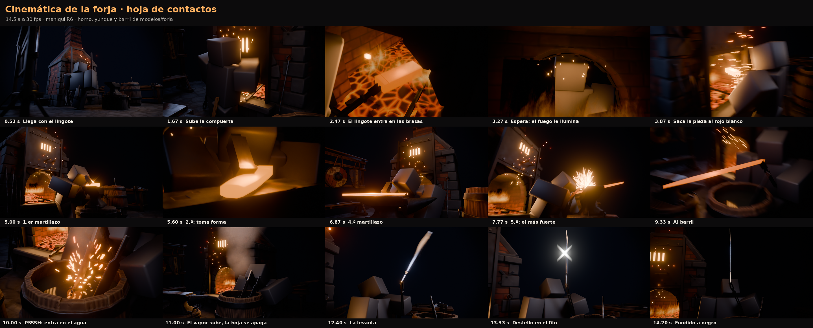

# Cinemática de la forja

Cinemática de 14,5 s (30 fps) del proceso de forjado: horno, yunque y temple, con un maniquí R6, los modelos de
`modelos/forja` (horno, yunque y barril), cámara cinematográfica y luz de fuego. Estilo herrería de Skyrim / Dark
Souls: oscuro, caliente y épico.

Todo sale de los scripts de `herramientas/` (Blender sin pantalla, `bpy` 5.2): nada está hecho a mano.

> **Nada de esto se ha visto todavía en Roblox Studio.** Esta sesión no tiene Studio. El vídeo es la referencia
> (render de Blender) y los datos de Roblox se han comprobado en Blender (ver [«Qué se ha comprobado y qué
> no»](#qué-se-ha-comprobado-y-qué-no)). Según CLAUDE.md, el director tiene que montarla en Studio y probarla con
> capturas antes de darla por buena.



## Qué hay aquí

| Archivo | Qué es |
| --- | --- |
| `cinematica_forja_1080p.mp4` | **Vídeo de referencia** 1920×1080, 30 fps, H.264 |
| `cinematica_forja_hoja_de_contactos.png` | 15 fotogramas clave con su tiempo |
| `cinematica_forja_keyframes.json` | **Todas las claves para recrearla en Roblox** (cámara, raíz, compuerta, calor de la pieza, partículas, luces y un muestreo a 10 fps de todo) |
| `roblox/CinematicaForjaDatos.luau` | Lo mismo que el JSON, como `ModuleScript` de datos (`--!strict`) |
| `cinematica_forja_r6_solo_huesos.fbx` | Animación del cuerpo: los 7 huesos R6 (para el Animation Editor) |
| `cinematica_forja_utileria.fbx` | Mallas nuevas: compuerta del horno y sus guías, tenazas, martillo y la pieza en sus 6 etapas |
| `forja_yunque_sin_martillo.fbx` | El yunque de `modelos/forja` sin el martillo grande apoyado en su cara (ver «Lo que se ha añadido a la forja») |
| `herramientas/` | Los scripts que lo generan todo (ver «Regenerar») |

## Guion

| Tiempo | Fotogramas | Plano | Qué pasa |
| --- | --- | --- | --- |
| **Fase 1 — El horno** | | | |
| 0,00–1,13 | 0–34 | General bajo | El herrero llega con el lingote en las tenazas, en alto como una antorcha. Ascuas saliendo del horno |
| 1,13–1,93 | 34–58 | Por encima del hombro | Se agacha, coge el asa y sube la compuerta de guillotina; la suelta y sigue subiendo sola. Estallido de chispas y la luz del fuego le inunda |
| 1,93–2,73 | 58–82 | Detalle del fuego | El lingote baja hacia la boca y se hunde en las brasas; empieza a ponerse naranja |
| 2,73–3,60 | 82–108 | Desde dentro del horno | Contraplano entre las llamas: el herrero espera con la cara iluminada; remueve la pieza |
| **Fase 2 — El yunque** | | | |
| 3,60–4,60 | 108–138 | Lateral siguiendo la pieza | La saca al rojo blanco (chispas), da un paso atrás, se gira y la baja sobre el yunque; saca el martillo que lleva a la espalda |
| 4,60–5,43 | 138–163 | Bajo, frente izquierdo | 1.er martillazo (5,00 s) con el horno de contraluz |
| 5,43–6,00 | 163–180 | Detalle del yunque | 2.º martillazo (5,60 s): la pieza se alarga y se afila |
| 6,00–7,13 | 180–214 | Frente derecho | 3.º (6,20 s) y 4.º (6,87 s) |
| 7,13–8,60 | 214–258 | Contrapicado extremo, lateral | 5.º y más fuerte (7,73 s); la pieza pasa a rojo oscuro |
| **Fase 3 — El temple** | | | |
| 8,60–9,67 | 258–290 | Siguiendo al herrero | Guarda el martillo, levanta la hoja del yunque y la lleva tumbada por encima del barril |
| 9,67–10,47 | 290–314 | Detalle del agua | La inclina hacia el agua y la hunde de un empujón a lo largo de la hoja: la punta entra a los 9,83 s. Salpicadura de chispas, burbujas, la superficie se agita |
| 10,47–12,07 | 314–362 | Plano medio | El vapor sube mientras la agita; la hoja pasa de rojo a gris metálico |
| **Fase 4 — El resultado** | | | |
| 12,07–14,53 | 362–436 | Giro alrededor de la hoja | La saca por donde entró y la levanta despacio, punta arriba; la cámara gira 70° a su alrededor; destello en el filo (13,07–13,60 s); fundido a negro desde 13,93 s |

Cada martillazo: anticipación (el brazo sube arriba y atrás y el torso se arma hacia atrás), golpe en 2-3
fotogramas con easing explosivo, **parada (hitstop) de 3 fotogramas** con el cuerpo volcado sobre el yunque,
temblor de cámara (de 0,55° a 2,1° según el golpe), destello de la luz de la pieza y una ráfaga de chispas
(70, 100, 140, 190 y 320), y rebote. Cada golpe arma más y cae más fuerte que el anterior.

La pieza va de lingote a hoja en 6 etapas (una por golpe) y su color sigue la temperatura de un cuerpo negro
(desplazado 500 K hacia el amarillo, como lo ve el ojo en la forja): ~1900 K (naranja blanco) al sacarla, 1200 K
(rojo) en el último golpe y apagada en el agua, donde pasa a gris metálico.

## Recrearla en Roblox

Todo está en `cinematica_forja_keyframes.json` / `roblox/CinematicaForjaDatos.luau`. Las posiciones están en
studs, ejes de Roblox, con el origen en el **centro del suelo de la forja a ras de tierra** (el mismo de
`modelos/forja/datos/forja_montaje.json`): si la forja está montada en otro sitio, multiplica todo por el CFrame
de ese origen. Los CFrame vienen como 12 números: `CFrame.new(table.unpack(c))`. Los easing vienen como
`{EasingStyle, EasingDirection}`; `"Constant"` quiere decir que el valor cambia de golpe al final del tramo.

Lo recomendado:

1. **Escena.** Monta la forja (`modelos/forja`, `MontarForja.luau`) con `forja_yunque_sin_martillo.fbx` en lugar
   de `forja_yunque.fbx` (mismo sitio y giro). Importa `cinematica_forja_utileria.fbx`
   (*Scale Unit = Stud*). La **compuerta** va delante de la boca del horno: su posición cerrada está en
   `compuerta.posicion_cerrada` y sube en Y lo que digan `compuerta.claves`. Pon a cada malla de la utilería su
   `PivotOffset` de `utileria_pivotes`: los CFrame del muestreo se refieren a ese punto (la mano en tenazas y
   martillo, la punta de las tenazas en la pieza).
2. **Cuerpo.** Importa `cinematica_forja_r6_solo_huesos.fbx` en el Animation Editor (como el puñetazo, ver
   `animaciones/README.md`), prioridad **Action**, sin bucle. Es la pose del cuerpo **sin desplazamiento**: el
   recorrido (andar al horno, al yunque y al barril) es el CFrame del `HumanoidRootPart` (anclado), que se tweenea
   con las claves de `raiz`.
3. **Cámara.** `CameraType = Scriptable`. Cada plano de `planos_camara` empieza con un corte seco
   (`CFrame.lookAt(posicion, mira_a)` y `FieldOfView`) y tweenea entre sus claves con su easing. Encima, el
   temblor de `temblores_camara` (un giro que decae: `grados * exp(-t / caida_s) * sin(...)`).
4. **Tenazas, martillo y pieza.** Su CFrame en el mundo está en `muestreo_10fps` (cada 0,1 s): lo más fiel es
   tweenearlos en lineal de muestra en muestra (piezas ancladas, sin Weld). Si se prefiere soldarlas a los brazos,
   `herramientas` da el C0 con el ángulo de agarre por defecto; el ángulo real cambia (la mano abre o cierra las
   tenazas para llegar sin codo), así que el muestreo es más exacto.
   Fuera de `martillo_en_mano` el martillo va colgado a la espalda (soldado al Torso; su CFrame también está en el
   muestreo).
5. **La pieza.** Cambia de malla (`Pieza_Etapa0` a `Pieza_Etapa5`) en cada martillazo (`pieza_etapa_claves`, o
   `impactos_s`). Su color y su luz están en `pieza_calor`: mientras está caliente, `Material = Neon` con el
   `Color` dado y un `PointLight`; al templarla, `Metal` con el gris y la `Reflectance` dados.
6. **Partículas** (`particulas`): las chispas de cada golpe son `:Emit(n)` en el `Attachment` «Golpe» del yunque en
   cada impacto; ascuas continuas en «Fuego» del horno; estallido al abrir la compuerta y al sacar la pieza; vapor
   en «Vapor» del barril al tocar el agua. Cada entrada trae sus ajustes (velocidad, vida, color...).
   Rendimiento en móvil: un solo emisor de chispas reutilizado para los 5 golpes.
7. **Luces y fundido** (`luces`): `PointLight` parpadeante dentro del horno, la luz de la boca que se enciende al
   abrir, y el fundido a negro con un `Frame` o un `ColorCorrectionEffect`.
8. **Sonido** (pendiente, se añade en Roblox): pasos, compuerta (arrastre de hierro), rugido del fuego, 5 golpes
   metálicos en `impactos_s` (más graves cuanto más fuerte), siseo del temple en `contacto_agua_s` y un brillo
   agudo con el destello.

Esqueleto del reproductor (**sin probar**: aquí no hay Studio; es una guía, no código del juego):

```lua
local TweenService = game:GetService("TweenService")
local Datos = require(script.Parent.CinematicaForjaDatos)

local function cf(c) return CFrame.new(table.unpack(c)) end
local function info(dur, easing)
	if easing[1] == "Constant" then return nil end
	return TweenInfo.new(dur, Enum.EasingStyle[easing[1]], Enum.EasingDirection[easing[2]])
end

-- Recorre una lista de claves {t, valor, easing} y llama a poner(valor) / tweenea con crear(valor, info)
local function reproducir(claves, poner, crear)
	for i = 2, #claves do
		local a, b = claves[i - 1], claves[i]
		task.delay(a.t, function()
			local ti = info(b.t - a.t, b.easing)
			if ti then crear(b, ti):Play() else task.delay(b.t - a.t, poner, b) end
		end)
	end
	poner(claves[1])
end
```

## Qué se ha comprobado y qué no

**Comprobado aquí** (scripts de `herramientas/`):

- **Alcance de los brazos.** R6 no tiene codo: cada brazo apunta y la mano «abre» o «cierra» la herramienta
  (ángulo de agarre) para que la punta llegue exacta. En todas las claves con objetivo (brasas, yunque, golpe,
  agua) la punta llega con error 0,00 studs; la mano en el asa de la compuerta, con 0,02–0,21 (queda dentro de la
  mano, que mide 1 stud).
- **Pies en el suelo:** la altura del torso se calcula en cada fotograma para que los pies pisen (error 0,00).
- **Sin choques:** `comprobar_choques.py` recorre los 436 fotogramas y lanza rayos por la pieza, las tenazas, el
  martillo y las 12 aristas de cada pieza del maniquí contra las mallas reales del horno, el yunque, el barril y el
  suelo: **0 choques** (la superficie del agua no cuenta). Con esta prueba se cambiaron la ruta de llegada, el sitio
  de cada parada, el giro al sacar la pieza (hacia la derecha, lejos del horno), el martillo (a la espalda) y el
  temple (empuje a lo largo de la hoja en vez de girarla: girada, barría la pared del barril).
- **Planos:** `comprobar_planos.py` lanza rayos desde la cámara al sujeto de cada plano. Lo que queda tapado es
  intencionado (el brazo que sube la compuerta, el brazo con las tenazas por delante del pecho, el borde del barril
  en el plano del vapor).
- **FBX del cuerpo:** se vuelve a importar y las articulaciones coinciden con la animación (desviación 0,0000
  studs en 9 fotogramas), 7 huesos R6 con su jerarquía, 436 fotogramas.

**NO comprobado:**

- **Nada en Roblox Studio**: la importación del FBX del cuerpo y de la utilería (sobre todo el giro de 180° de
  importación: se ha exportado como piezas de personaje, sin el giro de `modelos/forja`; si sale girada, gírala
  180° en Y), los CFrame del JSON sobre la forja montada, las partículas y cómo se ve con la luz de Roblox.
- El esqueleto del reproductor de arriba no se ha ejecutado.
- `lune run pruebas/ejecutar` no se ha ejecutado (no hay Lune en este entorno). No se ha tocado nada de `src/`.
- Los modelos de la forja (`modelos/forja`) vienen de la rama `claude/eloquent-cerf-uemkc7`, que todavía no está en
  `main`; están copiados tal cual en esta rama porque la cinemática los necesita.

## Lo que se ha añadido a la forja

- El horno de `modelos/forja` tiene la boca abierta. La cinemática pide abrir la puerta, así que hay una
  **compuerta de guillotina** de hierro (remaches, pletinas, mirilla con ranuras que dejan ver el fuego y asa a la
  derecha) que sube por dos guías. Abatible no cabía: al abrirse barrería el sitio donde está el herrero.
- `forja_yunque.fbx` trae un martillo grande apoyado **en medio de la cara del yunque**: la pieza no tiene dónde
  apoyarse (la parte libre de la cara mide 1,25 studs y la hoja 3,5) y el herrero ya golpea con su martillo. En la
  cinemática se quita (las dos islas de la malla que están enteras por encima de la cara: cabeza y mango, 80
  vértices) y se entrega `forja_yunque_sin_martillo.fbx`, igual que el original (mismos ejes, escala, UV y
  texturas, comprobado reimportándolo) pero sin ese martillo, para la estación de forja.
- El martillo del herrero va colgado a la espalda; al cogerlo y al dejarlo pasa a la mano en 6 fotogramas.
- Las herramientas se cogen por el borde interior de abajo del brazo (el pivote del hombro de R6 está en el borde
  del brazo, no en su centro). En el C0 de `herramientas` ya va así.

## Regenerar

Python 3.13 con `bpy` 5.2.3, `numpy` y `pillow` (`modelos/herramientas/requirements.txt`) y `ffmpeg`:

```bash
python animaciones/cinematica_forja/herramientas/documento.py
```

```bash
python animaciones/cinematica_forja/herramientas/render.py --previo 50,150,300 --ancho 640 --alto 360 --muestras 12 --carpeta /tmp/previo
```

```bash
python animaciones/cinematica_forja/herramientas/render.py --completo --muestras 10
```

```bash
python animaciones/cinematica_forja/herramientas/video.py
```

```bash
python animaciones/cinematica_forja/herramientas/comprobar_choques.py
```

```bash
python animaciones/cinematica_forja/herramientas/hornear.py -- --blend /tmp/escena.blend
```

```bash
python animaciones/cinematica_forja/herramientas/comprobar_planos.py --blend /tmp/escena.blend
```

| Script | Qué hace |
| --- | --- |
| `linea_tiempo.py` | **Todos los datos ajustables**: fotogramas, posiciones, poses, golpes, calor, luces, partículas y planos de cámara |
| `cinematica.py` | Convierte la línea de tiempo en movimiento: maniquí R6 (cinemática directa con los pivotes de `rig_r6`), apuntado de brazos con ángulo de agarre, piernas, herramientas, pieza y cámara |
| `escena.py` | Escena de Blender: la forja de `modelos/forja`, compuerta, utilería, maniquí, materiales (pieza de cuerpo negro, chispas, llamas, vapor), luces y composición (bloom, estrellas, viñeta) |
| `hornear.py` | Monta la escena y hornea una clave por fotograma |
| `render.py` | Render con Cycles (fotogramas sueltos o todos) |
| `video.py` | MP4 y hoja de contactos |
| `documento.py` | JSON, módulo Luau, FBX del cuerpo (y su verificación), FBX de la utilería y del yunque sin martillo |
| `comprobar_planos.py` | Comprueba qué tapa al sujeto de cada plano |
| `comprobar_choques.py` | Comprueba que nada atraviesa el horno, el yunque, el barril ni el suelo |

El render completo a 1080p tarda horas en CPU: con 4 núcleos y 10 muestras (más el denoiser OIDN), unos 20-30 s por
fotograma y 60-90 s en los planos con vapor.
