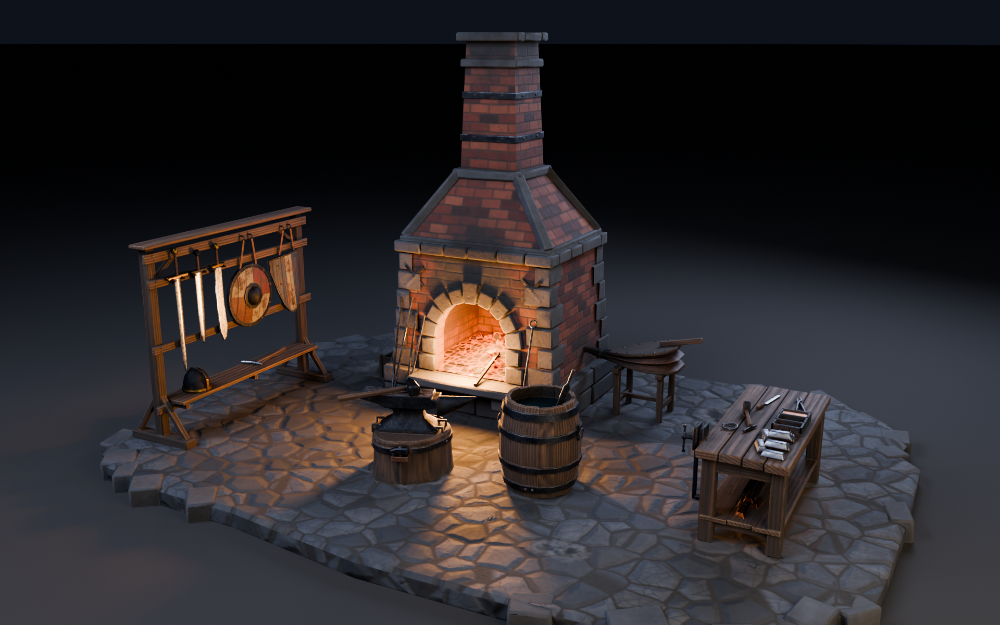
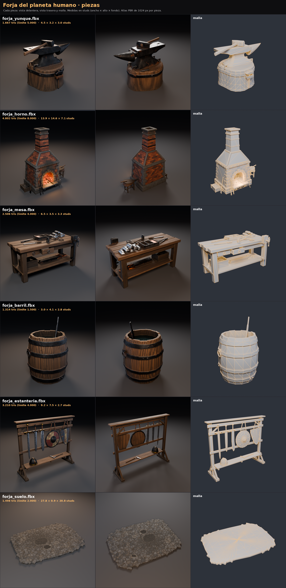

# Forja / herrería del planeta humano

Herrería medieval oscura y usada (referencia: Skyrim / Dark Souls), en seis piezas sueltas para montar en Roblox.
Todo sale de los scripts de `herramientas/` (Blender sin pantalla, `bpy`): nada está hecho a mano.

> **Nada de esto se ha visto todavía en Roblox Studio.** Esta sesión no tiene Studio. Los FBX se han vuelto a
> importar en Blender y pasan las comprobaciones de abajo, pero según CLAUDE.md el director tiene que importarlos
> y probarlos en Studio, con capturas, antes de darlos por buenos. Ver [«Qué se ha comprobado y qué no»](#qué-se-ha-comprobado-y-qué-no).





`renders/forja_montada_2.png` es otra vista, de frente, con una figura R6 (5 studs) para ver la escala.

## Piezas

| Archivo | Qué lleva | Triángulos | Límite | Tamaño (studs: ancho × alto × fondo) |
| --- | --- | ---: | ---: | --- |
| `forja_yunque.fbx` | Yunque de hierro con la mesa pulida por el uso, sobre un tocón con aro de hierro y grapas; martillo grande apoyado en la mesa, martillo pequeño colgado de una tira de cuero y un punzón | 1.667 | 5.000 | 4,5 × 3,2 × 3,0 |
| `forja_horno.fbx` | Horno de ladrillo sobre zócalo de sillares, boca en arco con dovelas, cámara con lecho de brasas, campana, chimenea con aros de hierro, fuelle de cuero sobre caballetes, dos tenazas largas, atizador, carbonera y pala | 4.802 | 8.000 | 13,9 × 14,6 × 7,1 |
| `forja_mesa.fbx` | Mesa de tablones con tenazas, lima, molde de lingotes, lingotes apilados, martillo, cincel, herraduras y tornillo de banco; dos cajones (uno a medio abrir) y balda con carbón, barras y lingotes de cobre | 2.506 | 4.000 | 6,5 × 3,5 × 3,3 |
| `forja_barril.fbx` | Barril de duelas con cuatro aros de hierro, asas, lleno de agua sucia, con una hoja a medio forjar dentro | 1.314 | 1.500 | 3,0 × 4,1 × 2,8 |
| `forja_estanteria.fbx` | Estantería de madera con clavijas y ganchos: 3 espadas (larga, corta y alfanje), escudo redondo, escudo de lágrima, yelmo y hacha de mano | 3.210 | 4.000 | 9,2 × 7,5 × 2,7 |
| `forja_suelo.fbx` | Plataforma de adoquín de borde irregular con piedras sueltas, hollín y marcas de quemado | 1.498 | 2.000 | 27,8 × 0,9 × 20,8 |

`forja_horno.fbx` trae **dos mallas**: `forja_horno` y `forja_horno_brasas` (las brasas y el carbón encendido, 4.802
triángulos entre las dos). Van aparte para poder ponerlas en **Neon**.

Las normales miran hacia fuera, no hay caras sueltas sin grosor y las partes tapadas (el fondo de los sillares
pegados al muro, por ejemplo) no existen: no gastan triángulos ni atlas.

## Texturas

Un atlas de **1024 × 1024 por pieza** en `texturas/`, horneado en Blender a partir de materiales procedurales:

| Archivo | Para la `SurfaceAppearance` |
| --- | --- |
| `<pieza>_color.png` | `ColorMap` (lleva la oclusión ambiental dentro) |
| `<pieza>_normal.png` | `NormalMap` (formato OpenGL, Y+, el de Roblox; incluye el relieve y las aristas redondeadas) |
| `<pieza>_rugosidad.png` | `RoughnessMap` |
| `<pieza>_metal.png` | `MetalnessMap` |
| `forja_horno_emision.png` | Luz propia del horno (brasas y ladrillo al rojo de la cámara). Solo sirve si la `SurfaceAppearance` de tu versión de Studio admite emisión; si no, se ignora y las brasas brillan con Neon |

Nada está limpio: madera marrón cálido con veta, grietas y cantos pelados; hierro oscuro con golpes, canto vivo y
óxido naranja; ladrillo rojizo con junta sucia y ladrillos requemados; piedra gris oscuro; hollín alrededor de la
boca del horno, de la chimenea y por el suelo. Los colores y tonos se ajustan en `herramientas/nodos.py` (`COLORES`).

## Importar en Studio

1. **File → Import 3D**, elige el `.fbx`. En el importador: **Scale Unit = Stud** (1 unidad de Blender = 1 stud),
   *Anchored* activado, *Import only as model* activado.
2. **Giro de importación: ya está aplicado.** Las mallas de este proyecto entran en Studio giradas 180° sobre el eje
   vertical (el Y de Roblox; ver `MontarRegion.GIRO_IMPORTACION` en la región 1). Aquí ese giro se aplica a la malla
   antes de exportar (`proceso.GIRO_IMPORTACION`), así que **no hay que volver a girarlas** en Studio.
3. **Texturas.** Cada FBX lleva incrustados el color y las normales, y el importador suele crear la
   `SurfaceAppearance` con ellos. Añade a mano `RoughnessMap` y `MetalnessMap` (súbelas con *Asset Manager → Bulk
   Import*). Si no se crea sola, pon las cuatro.
4. **Brasas** (`forja_horno_brasas`): Material **Neon**, color `#FF7828`, sin `SurfaceAppearance`, `CanCollide`
   apagado.
5. **Efectos** (no están modelados, son de Roblox). `datos/<pieza>.json` da la posición de cada `Attachment`:
   - Horno: `Humo` (encima de la chimenea, `ParticleEmitter`), `Luz` (en la boca, `PointLight` naranja, alcance ~26)
     y `Fuego` (dentro de la cámara, para llamas o chispas).
   - Barril: `Vapor` (sobre el agua).
   - Yunque: `Golpe` (centro de la mesa, para las chispas del martillazo).
6. **Colisión**: para móvil, `CollisionFidelity = Box` en mesa, barril y estantería y `Hull` en el yunque; el horno
   y el suelo necesitan `PreciseConvexDecomposition` o cajas invisibles. `RenderFidelity = Automatic`.

### Montarla entera

`datos/forja_montaje.json` da el centro de cada `MeshPart` (studs, ejes de Roblox, respecto al centro del suelo a ras
de tierra) y su giro sobre Y, como en el render. `roblox/MontarForja.luau` coloca las piezas con esos datos, pone
las brasas en Neon y crea los `Attachment`, la luz del fuego y los emisores de humo y vapor. **El script no se ha
ejecutado ni pasado por el analizador** (aquí no hay Studio ni Lune).

La disposición se cambia en `herramientas/piezas.py` (`MONTAJE`); el suelo pinta las quemaduras donde quedan el
horno, el yunque y el barril.

## Qué se ha comprobado y qué no

**Comprobado aquí** (`herramientas/verificar.py`, que vuelve a importar cada FBX en una escena vacía):

- Triángulos por debajo del límite en las seis piezas, y los mismos que en `datos/`.
- Tamaño en studs igual al del modelo original.
- UV presentes y dentro de 0–1; texturas de 1024 × 1024.
- Caras del revés: cada pieza se renderiza desde 8 puntos con un material que pinta de blanco la cara trasera; el
  resultado es ~0 % de píxeles.
- Los renders de arriba usan las texturas horneadas (lo mismo que verá Roblox), no los materiales procedurales.

**NO comprobado:**

- **Nada en Roblox Studio**: la importación (escala, que el giro ya aplicado deje las piezas como en
  `forja_montaje.json`), cómo se ven los mapas PBR con la luz de Roblox, la colisión y el rendimiento en móvil.
- `roblox/MontarForja.luau`: sin ejecutar y sin analizar.
- `lune run pruebas/ejecutar` no se ha ejecutado (no hay Lune en este entorno). No se ha tocado nada de `src/`.

## Lo que queda fuera

- El humo, el vapor y las chispas son partículas de Roblox: aquí solo están sus anclajes.
- Las armas de la estantería y las herramientas son parte de la malla de su pieza (decoración): no se pueden coger.
  Si el juego necesita un martillo o una espada sueltos, habría que exportarlos aparte.
- No hay versiones de lejos (LOD): la forja entera son ~15.000 triángulos y 6 atlas.

## Regenerar

Python 3.13 con `bpy` 5.2.3, `numpy` y `pillow` (`modelos/herramientas/requirements.txt`):

```bash
python modelos/forja/herramientas/forja.py                 # las 6 piezas: malla, atlas PBR, FBX y datos (~10 min cada una)
```

```bash
python modelos/forja/herramientas/forja.py --piezas yunque --tam 512   # una sola, rápida, con vista de prueba
```

```bash
python modelos/forja/herramientas/verificar.py             # comprobaciones sobre los FBX
```

```bash
python modelos/forja/herramientas/hojas.py                 # renders, hoja de piezas y forja_montaje.json
```

| Script | Qué hace |
| --- | --- |
| `malla.py` | Constructor de mallas low-poly en studs (cajas, tablas, tornos, tubos, prismas, bloques) con el atributo `tex` que orienta la veta y las hiladas |
| `nodos.py` | Materiales PBR procedurales (madera, hierro, ladrillo, sillar, adoquín, cuero, brasa, agua) y la capa común de mugre, hollín y cantos gastados. `COLORES` reúne todos los tonos |
| `piezas.py` | Las seis piezas y `MONTAJE` (dónde va cada una) |
| `proceso.py` | UV, horneado del atlas, exportación FBX (con `GIRO_IMPORTACION`) y utilidades de render |
| `forja.py` | Lo ejecuta todo pieza a pieza |
| `hojas.py` | Render de la forja montada, hoja de piezas y datos de montaje |
| `verificar.py` | Comprobaciones sobre los FBX exportados |
