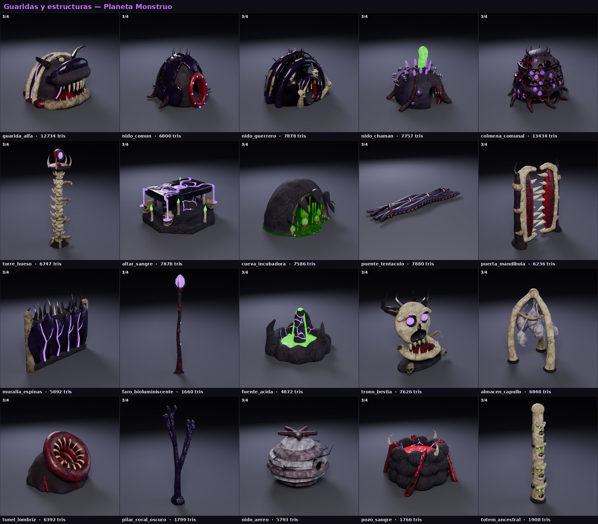
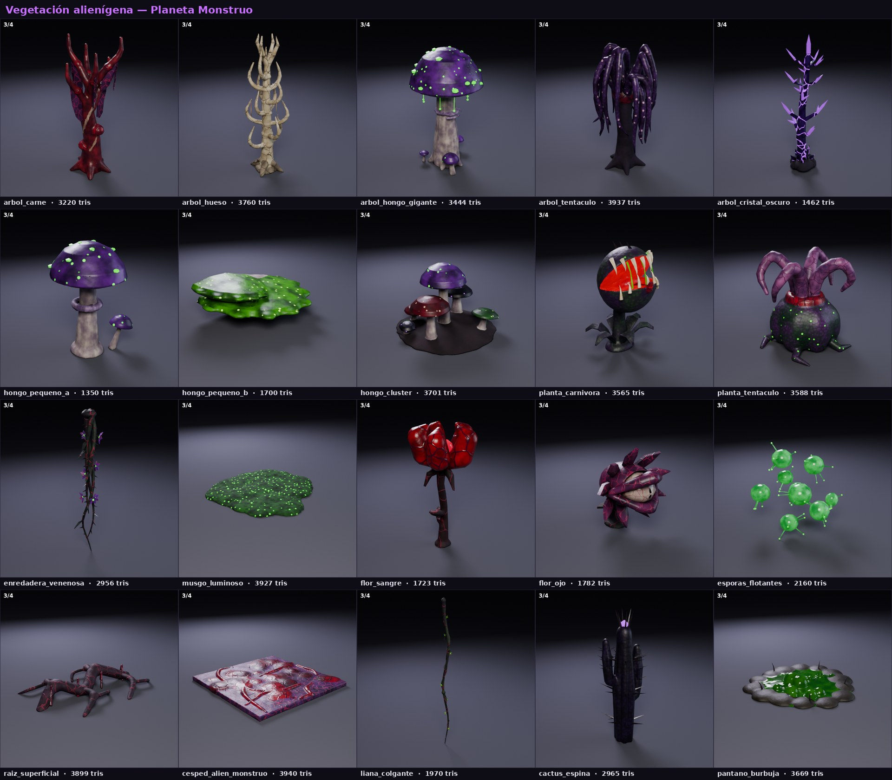
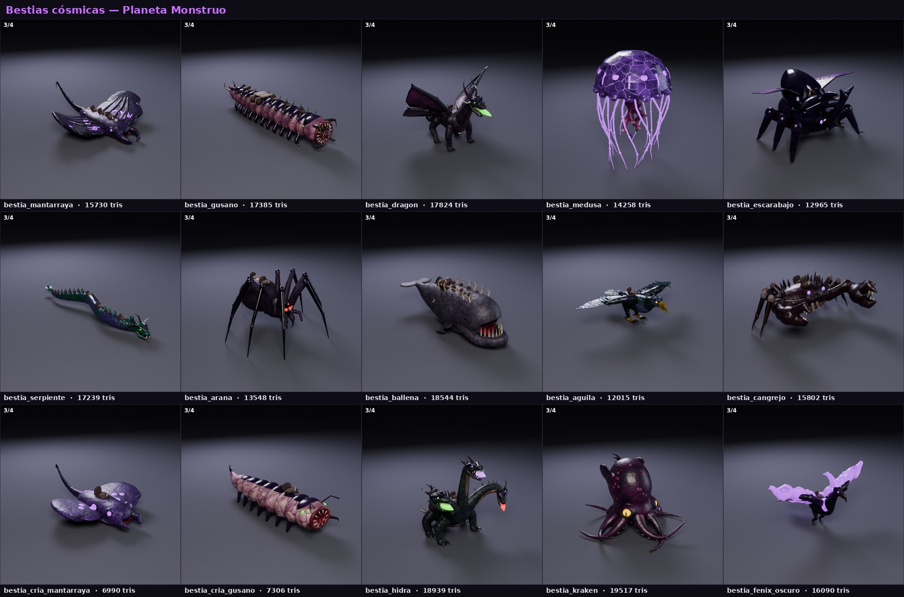
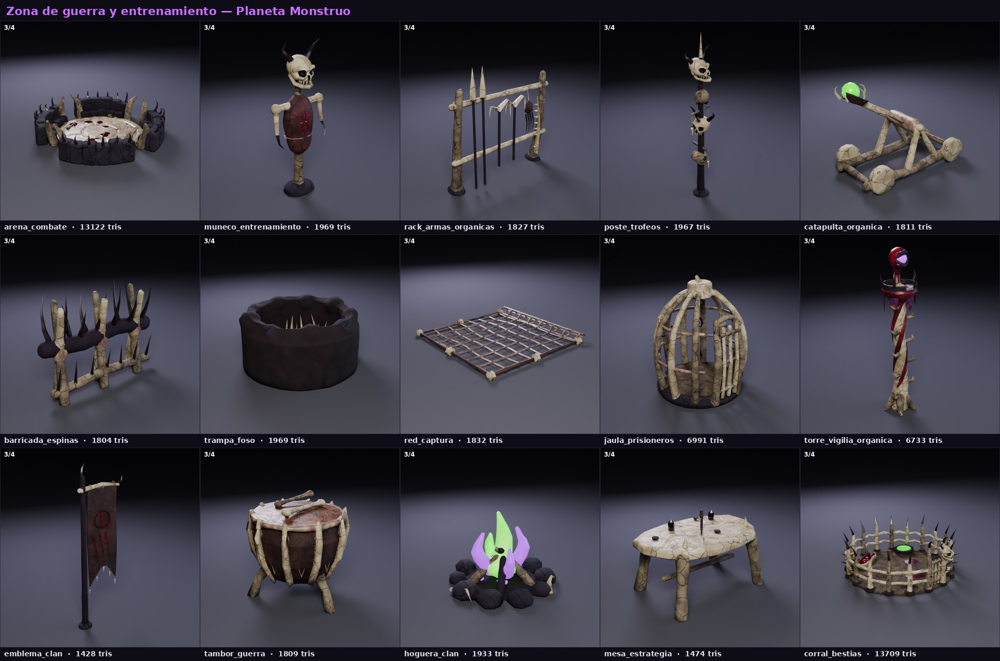
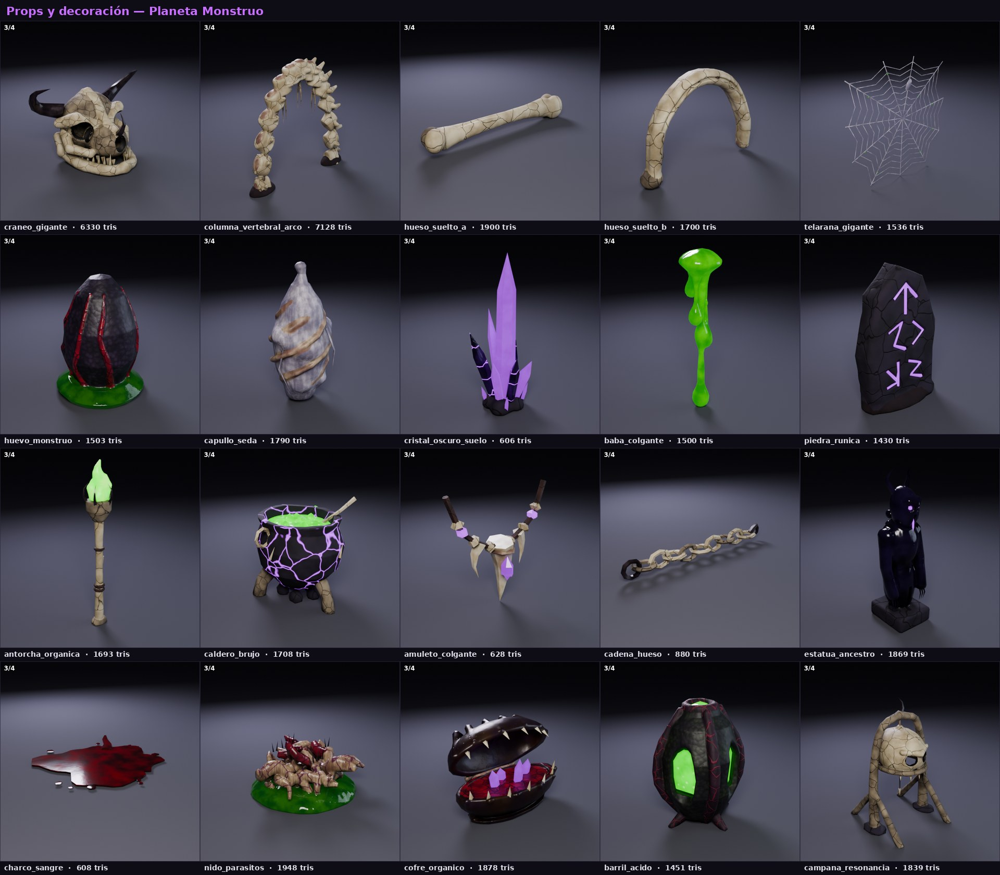
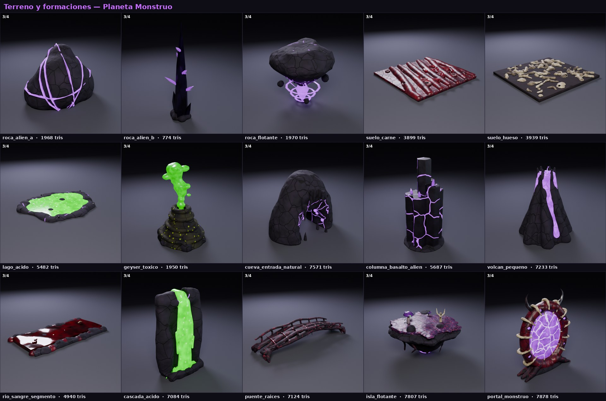

# Planeta Monstruo: modelos 3D

105 modelos del hogar de los monstruos (587.965 triángulos en total): guaridas, vegetación, las bestias
cósmicas que hacen de naves, la zona de guerra, props y terreno. Todo es biología, hueso, cristal y carne; nada de
metal ni tecnología.

Están generados con scripts de Python en Blender sin pantalla (`bpy`): no hay nada hecho a mano y todo se puede
regenerar desde `modelos/herramientas/planeta_monstruo/`.

**Estado: sin probar en Roblox Studio.** Cada FBX se ha reimportado en Blender y se ha comprobado (piezas,
triángulos, tamaño, normales hacia fuera y UV), pero ninguno se ha importado todavía en Studio. Hasta que el
director los vea en Studio con capturas, no están dados por buenos.

## Qué hay en cada carpeta

`<nombre>/` contiene:

| Archivo | Qué es |
| --- | --- |
| `<nombre>.fbx` | El modelo, con una malla por pieza. 1 unidad = 1 stud. |
| `<nombre>_color.png` | Atlas 1024 de color (con la oclusión ambiental ya metida). |
| `<nombre>_normal.png` | Normales (espacio tangente, formato OpenGL, Y+). |
| `<nombre>_roughness.png` · `<nombre>_metalness.png` | Rugosidad y metal, en gris. |
| `<nombre>_emision.png` | Emisión. Solo si el modelo tiene partes que brillan. |
| `<nombre>_turnaround.png` | 6 vistas: frente, 3/4, lateral, 3/4 trasera, arriba y malla. |
| `<nombre>.json` | Triángulos, tamaño en studs, piezas, verificación del FBX y, si las hay, articulaciones y monturas. |
| `montar_<nombre>.luau` | Solo en las bestias: script para la barra de comandos que las monta con Motor6D y asientos. |

Todas las piezas de un modelo comparten el mismo atlas.

## Convenciones

- **Escala:** 1 unidad de Blender = 1 stud, exportado con *Apply Scalings: FBX All*. Si en Studio un modelo sale
  3,57 veces más grande o más pequeño, es la unidad del importador: en *File General → Scale Unit* elige **Stud**.
- **Giro de importación:** los modelos se exportan ya girados 180° sobre la vertical: en el archivo FBX el frente
  mira a +Z y, como el importador de Studio gira las mallas 180° (ver `MontarRegion.GIRO_IMPORTACION`), en Studio
  quedan mirando a -Z, el «delante» de Roblox. Las posiciones de los JSON (centros, pivotes, monturas) están en
  studs, relativas al origen del modelo y en los ejes del archivo FBX. Los scripts de montaje de las bestias
  averiguan solos cómo ha quedado girado el modelo, así que funcionan aunque Studio no lo gire o lo gires tú.
- **Origen:** el centro de la base. En lo que cuelga (lianas, capullos, nido aéreo, baba, amuleto, enredadera), el
  centro de arriba. En lo que flota (esporas, roca e isla flotantes), el centro. Lo dice el campo `origen` del JSON.
- **Piezas que brillan:** van en mallas aparte con sufijo `_neon` o `_biolum`: ponles `Material = Neon` y el color
  que indica `roblox.color` en el JSON (violeta `#C04DFF`, verde `#39FF14`...). Las `_cristal` son translúcidas:
  `Material = Glass` y la transparencia de `roblox.transparencia`. El resto lleva `SurfaceAppearance` con los cuatro
  mapas (`ColorMap`, `NormalMap`, `RoughnessMap`, `MetalnessMap`).
- **Todo tiene volumen:** no hay planos sueltos. Membranas, banderas, pétalos, telarañas e hilos tienen grosor.
- **Presupuesto de triángulos:** estructuras grandes 15.000, medianas 8.000, props 2.000, vegetación 4.000, bestias
  20.000 y crías 8.000. El campo `presupuesto_triangulos` de cada JSON dice cuál le toca.

## Bestias cósmicas

Las «naves» de los monstruos. Van por piezas rígidas (cabeza, cuerpo, alas o patas, cola...), sin huesos ni
deformación, igual que los enemigos R6.

1. Importa el FBX, selecciona el modelo importado y pega `montar_<nombre>.luau` en la barra de comandos.
2. El script junta las piezas en un `Model`, une cada pieza móvil a su padre con un `Motor6D` en su articulación,
   suelda las demás, crea un `Seat` por punto de montura y añade `AnimationController` + `Animator`.
3. En el JSON: `articulaciones` (pieza, padre y pivote), `puntos_montura` (posición y hacia dónde mira cada asiento)
   y, en las grandes (ballena, gusano, hidra), `bahia_carga`.

Los asientos tienen su silla modelada en el lomo, así que el punto de montura se ve en el propio modelo.

## Modelos con partes móviles que no son bestias

`puerta_mandibula`, `jaula_prisioneros`, `corral_bestias`, `catapulta_organica`, `cofre_organico` y
`campana_resonancia` llevan la parte móvil en una malla aparte y su pivote en `articulaciones`. `arbol_tentaculo`
lleva tres poses de los tentáculos (`tentaculos_pose_a/b/c`): se muestra una cada vez.

## Regenerar

```bash
pip install bpy scikit-image scipy pillow numpy
```

```bash
python modelos/herramientas/planeta_monstruo/ejecutar.py --ronda 1 -j 4
```

```bash
python modelos/herramientas/planeta_monstruo/ejecutar.py bestia_dragon
```

```bash
python modelos/herramientas/planeta_monstruo/indice.py
```

`lib.py` es la cadena completa (modelado por volumen, materiales procedurales, horneado, turnaround, FBX,
verificación y JSON); `ronda_XX.py` son los modelos, diez por archivo; `formas.py`, las formas que se repiten
(cráneos, huesos, setas, sillas), que se generan de nuevo en cada modelo con sus propias proporciones.

## Los modelos

### Guaridas y estructuras (20)



| Modelo | Triángulos | Tamaño en studs (ancho X × alto Y × fondo Z) | Piezas |
| --- | ---: | --- | --- |
| `guarida_alfa` | 12.734 | 20.0 × 14.0 × 18.0 | `guarida`, `venas_neon`, `ojos_neon` |
| `nido_comun` | 6.800 | 8.0 × 6.0 × 8.0 | `nido`, `bulbos_biolum` |
| `nido_guerrero` | 7.878 | 10.0 × 7.0 × 8.0 | `nido` |
| `nido_chaman` | 7.757 | 10.0 × 8.0 × 10.0 | `nido`, `hongos_neon`, `cristales_cristal`, `humo_neon` |
| `colmena_comunal` | 13.434 | 16.0 × 12.0 × 14.0 | `colmena`, `resina_neon` |
| `torre_hueso` | 6.747 | 4.0 × 16.0 × 4.0 | `torre`, `ojo_neon` |
| `altar_sangre` | 7.878 | 6.0 × 3.0 × 6.0 | `altar`, `canales_neon`, `velas_biolum` |
| `cueva_incubadora` | 7.586 | 10.0 × 6.0 × 8.0 | `cueva`, `huevos_cristal`, `embriones_neon` |
| `puente_tentaculo` | 7.880 | 12.0 × 1.0 × 3.0 | `puente` |
| `puerta_mandibula` | 6.236 | 6.0 × 8.0 × 2.0 | `marco`, `mandibula_izq`, `mandibula_der` |
| `muralla_espinas` | 5.892 | 6.0 × 5.0 × 1.0 | `muralla`, `venas_neon` |
| `faro_bioluminiscente` | 1.660 | 1.0 × 8.0 × 1.0 | `faro`, `bulbo_neon` |
| `fuente_acida` | 4.872 | 5.0 × 3.0 × 5.0 | `fuente`, `acido_neon` |
| `trono_bestia` | 7.626 | 4.0 × 5.0 × 3.0 | `trono`, `ojos_neon` |
| `almacen_capullo` | 6.848 | 4.0 × 6.0 × 4.0 | `armazon`, `capullos` |
| `tunel_lombriz` | 6.392 | 4.0 × 3.0 × 4.0 | `tunel` |
| `pilar_coral_oscuro` | 1.799 | 2.0 × 8.0 × 2.0 | `coral`, `puntos_neon` |
| `nido_aereo` | 5.793 | 6.0 × 5.0 × 6.0 | `nido` |
| `pozo_sangre` | 1.766 | 3.0 × 2.0 × 3.0 | `pozo`, `liquido_neon` |
| `totem_ancestral` | 1.908 | 2.0 × 10.0 × 2.0 | `totem`, `ojos_neon` |

### Vegetación alienígena (20)



| Modelo | Triángulos | Tamaño en studs (ancho X × alto Y × fondo Z) | Piezas |
| --- | ---: | --- | --- |
| `arbol_carne` | 3.220 | 5.0 × 14.0 × 5.0 | `arbol` |
| `arbol_hueso` | 3.760 | 4.0 × 12.0 × 4.0 | `arbol` |
| `arbol_hongo_gigante` | 3.444 | 6.0 × 10.0 × 6.0 | `hongo`, `esporas_neon` |
| `arbol_tentaculo` | 3.937 | 5.0 × 10.0 × 5.0 | `tronco`, `tentaculos_pose_a`, `tentaculos_pose_b`, `tentaculos_pose_c` |
| `arbol_cristal_oscuro` | 1.462 | 4.0 × 12.0 × 4.0 | `base`, `tronco`, `ramas_neon` |
| `hongo_pequeno_a` | 1.350 | 1.0 × 1.5 × 1.0 | `hongo`, `puntos_neon` |
| `hongo_pequeno_b` | 1.700 | 1.5 × 0.5 × 1.0 | `hongo` |
| `hongo_cluster` | 3.701 | 3.0 × 2.0 × 3.0 | `hongos` |
| `planta_carnivora` | 3.565 | 2.0 × 3.0 × 2.0 | `planta` |
| `planta_tentaculo` | 3.588 | 2.0 × 2.0 × 2.0 | `planta` |
| `enredadera_venenosa` | 2.956 | 1.0 × 6.0 × 1.0 | `enredadera` |
| `musgo_luminoso` | 3.927 | 4.0 × 0.2 × 4.0 | `musgo`, `brotes_neon` |
| `flor_sangre` | 1.723 | 0.5 × 1.0 × 0.5 | `flor`, `gota_neon` |
| `flor_ojo` | 1.782 | 1.0 × 1.0 × 1.0 | `flor`, `ojo` |
| `esporas_flotantes` | 2.160 | 3.0 × 3.0 × 3.0 | `velos_cristal`, `nucleos_neon` |
| `raiz_superficial` | 3.899 | 6.0 × 1.0 × 4.0 | `raices` |
| `cesped_alien_monstruo` | 3.940 | 8.0 × 0.6 × 8.0 | `placa` |
| `liana_colgante` | 1.970 | 0.5 × 8.0 × 0.5 | `liana` |
| `cactus_espina` | 2.965 | 2.0 × 5.0 × 2.0 | `cactus`, `flor_neon` |
| `pantano_burbuja` | 3.669 | 4.0 × 0.5 × 4.0 | `pantano` |

### Bestias cósmicas (15)



| Modelo | Triángulos | Tamaño en studs (ancho X × alto Y × fondo Z) | Piezas |
| --- | ---: | --- | --- |
| `bestia_mantarraya` | 15.730 | 20.0 × 6.0 × 24.0 · 3 asientos | `cuerpo`, `cuerpo_neon`, `ala_izq`, `ala_izq_neon`, `ala_der`, `ala_der_neon`, `cola` |
| `bestia_gusano` | 17.385 | 6.0 × 6.0 × 30.0 · 5 asientos | `cabeza`, `ojos_neon`, `cuerpo_delantero`, `cuerpo_medio`, `cuerpo_trasero`, `cola` |
| `bestia_dragon` | 17.824 | 18.0 × 14.0 × 20.0 · 2 asientos | `cuerpo`, `cuello`, `cabeza`, `ojos_neon`, `mandibula`, `aliento_neon`, `cola`, `pata_del_izq`, `pata_tras_izq`, `pata_del_der`, `pata_tras_der`, `ala_sup_izq`, `ala_inf_izq`, `ala_sup_der`, `ala_inf_der` |
| `bestia_medusa` | 14.258 | 12.0 × 18.0 × 12.0 · 1 asientos | `campana_cristal`, `patrones_neon`, `nucleo`, `brazos_orales`, `tentaculos_a_neon`, `tentaculos_b_neon` |
| `bestia_escarabajo` | 12.965 | 10.0 × 6.0 × 8.0 · 2 asientos | `cuerpo`, `cabeza`, `ojos_neon`, `elitro_izq`, `ala_izq`, `pata_1_izq`, `pata_2_izq`, `pata_3_izq`, `elitro_der`, `ala_der`, `pata_1_der`, `pata_2_der`, `pata_3_der` |
| `bestia_serpiente` | 17.239 | 4.0 × 4.0 × 24.0 · 3 asientos | `cuerpo_1`, `cuerpo_2`, `cuerpo_3`, `cuerpo_4`, `cola`, `cabeza`, `ojos_neon`, `mandibula` |
| `bestia_arana` | 13.548 | 14.0 × 8.0 × 14.0 · 2 asientos | `cuerpo`, `ojos_neon`, `abdomen`, `pata_1_izq`, `pata_2_izq`, `pata_3_izq`, `pata_4_izq`, `pata_1_der`, `pata_2_der`, `pata_3_der`, `pata_4_der` |
| `bestia_ballena` | 18.544 | 10.0 × 10.0 × 28.0 · 8 asientos | `cuerpo`, `mandibula`, `aleta_izq`, `aleta_der`, `cola`, `percebes_neon` |
| `bestia_aguila` | 12.015 | 18.0 × 6.0 × 14.0 · 1 asientos | `cuerpo`, `cabeza`, `ojos_neon`, `ala_izq`, `garra_izq`, `ala_der`, `garra_der`, `cola` |
| `bestia_cangrejo` | 15.802 | 14.0 × 6.0 × 12.0 · 2 asientos | `cuerpo`, `ojos_neon`, `pinza_izq`, `dedo_izq`, `pata_1_izq`, `pata_2_izq`, `pata_3_izq`, `pata_4_izq`, `pinza_der`, `dedo_der`, `pata_1_der`, `pata_2_der`, `pata_3_der`, `pata_4_der` |
| `bestia_cria_mantarraya` | 6.990 | 8.0 × 3.0 × 10.0 · 1 asientos | `cuerpo`, `manchas_neon`, `ala_izq`, `ala_der`, `cola` |
| `bestia_cria_gusano` | 7.306 | 3.0 × 3.0 × 12.0 · 1 asientos | `cabeza`, `ojos_neon`, `cuerpo_delantero`, `cuerpo_trasero`, `cola` |
| `bestia_hidra` | 18.939 | 16.0 × 14.0 × 14.0 · 1 asientos | `cuerpo`, `cola`, `pata_del_izq`, `pata_tras_izq`, `pata_del_der`, `pata_tras_der`, `cuello_verde`, `cabeza_verde`, `ojos_verde_neon`, `mandibula_verde`, `aliento_verde_neon`, `cuello_violeta`, `cabeza_violeta`, `ojos_violeta_neon`, `mandibula_violeta`, `aliento_violeta_neon`, `cuello_roja`, `cabeza_roja`, `ojos_roja_neon`, `mandibula_roja`, `aliento_roja_neon` |
| `bestia_kraken` | 19.517 | 14.0 × 10.0 × 14.0 · 1 asientos | `manto`, `pico`, `ojos_neon`, `tentaculo_1`, `tentaculo_2`, `tentaculo_3`, `tentaculo_4`, `tentaculo_5`, `tentaculo_6`, `tentaculo_7`, `tentaculo_8` |
| `bestia_fenix_oscuro` | 16.090 | 20.0 × 10.0 × 16.0 · 1 asientos | `cuerpo`, `cabeza`, `ojos_neon`, `cresta_fuego_neon`, `ala_izq`, `ala_fuego_izq_neon`, `ala_der`, `ala_fuego_der_neon`, `cola_fuego_neon` |

### Zona de guerra y entrenamiento (15)



| Modelo | Triángulos | Tamaño en studs (ancho X × alto Y × fondo Z) | Piezas |
| --- | ---: | --- | --- |
| `arena_combate` | 13.122 | 16.0 × 4.0 × 16.0 | `arena` |
| `muneco_entrenamiento` | 1.969 | 2.0 × 5.0 × 1.0 | `muneco` |
| `rack_armas_organicas` | 1.827 | 4.0 × 4.0 × 1.0 | `rack` |
| `poste_trofeos` | 1.967 | 1.0 × 6.0 × 1.0 | `poste` |
| `catapulta_organica` | 1.811 | 4.0 × 3.0 × 2.0 | `bastidor`, `brazo`, `proyectil_neon` |
| `barricada_espinas` | 1.804 | 4.0 × 3.0 × 1.0 | `barricada` |
| `trampa_foso` | 1.969 | 4.0 × 2.0 × 4.0 | `foso` |
| `red_captura` | 1.832 | 4.0 × 0.3 × 4.0 | `red` |
| `jaula_prisioneros` | 6.991 | 4.0 × 5.0 × 4.0 | `jaula`, `puerta` |
| `torre_vigilia_organica` | 6.733 | 3.0 × 14.0 × 3.0 | `torre`, `ojo_neon` |
| `emblema_clan` | 1.428 | 2.0 × 6.0 × 0.5 | `estandarte` |
| `tambor_guerra` | 1.809 | 3.0 × 3.0 × 3.0 | `tambor` |
| `hoguera_clan` | 1.933 | 3.0 × 2.0 × 3.0 | `hoguera`, `fuego_neon`, `brasas_neon` |
| `mesa_estrategia` | 1.474 | 3.0 × 2.0 × 2.0 | `mesa` |
| `corral_bestias` | 13.709 | 10.0 × 4.0 × 10.0 | `corral`, `abrevadero_neon`, `puerta` |

### Props y decoración (20)



| Modelo | Triángulos | Tamaño en studs (ancho X × alto Y × fondo Z) | Piezas |
| --- | ---: | --- | --- |
| `craneo_gigante` | 6.330 | 6.0 × 4.0 × 4.0 | `craneo` |
| `columna_vertebral_arco` | 7.128 | 6.0 × 6.0 × 1.0 | `arco` |
| `hueso_suelto_a` | 1.900 | 3.0 × 0.5 × 0.5 | `femur` |
| `hueso_suelto_b` | 1.700 | 2.0 × 1.5 × 0.3 | `costilla` |
| `telarana_gigante` | 1.536 | 6.0 × 6.0 × 0.1 | `telarana` |
| `huevo_monstruo` | 1.503 | 1.5 × 2.0 × 1.5 | `huevo`, `interior_neon` |
| `capullo_seda` | 1.790 | 1.0 × 2.0 × 1.0 | `capullo` |
| `cristal_oscuro_suelo` | 606 | 1.0 × 3.0 × 1.0 | `base`, `cristal_neon` |
| `baba_colgante` | 1.500 | 0.5 × 2.0 × 0.5 | `baba_cristal` |
| `piedra_runica` | 1.430 | 2.0 × 3.0 × 1.0 | `piedra`, `runas_neon` |
| `antorcha_organica` | 1.693 | 0.5 × 3.0 × 0.5 | `antorcha`, `llama_neon` |
| `caldero_brujo` | 1.708 | 2.0 × 2.0 × 2.0 | `caldero`, `pocion_neon` |
| `amuleto_colgante` | 628 | 1.0 × 1.0 × 0.3 | `amuleto`, `gemas_neon` |
| `cadena_hueso` | 880 | 4.0 × 0.5 × 0.5 | `cadena` |
| `estatua_ancestro` | 1.869 | 2.0 × 6.0 × 2.0 | `estatua`, `ojos_neon` |
| `charco_sangre` | 608 | 3.0 × 0.1 × 3.0 | `charco` |
| `nido_parasitos` | 1.948 | 2.0 × 1.0 × 2.0 | `nido` |
| `cofre_organico` | 1.878 | 2.0 × 1.5 × 1.5 | `base`, `tapa`, `tesoro_neon` |
| `barril_acido` | 1.451 | 1.5 × 2.0 × 1.5 | `vaina`, `acido_neon` |
| `campana_resonancia` | 1.839 | 2.0 × 3.0 × 2.0 | `soporte`, `campana`, `badajo` |

### Terreno y formaciones (15)



| Modelo | Triángulos | Tamaño en studs (ancho X × alto Y × fondo Z) | Piezas |
| --- | ---: | --- | --- |
| `roca_alien_a` | 1.968 | 4.0 × 3.0 × 3.0 | `roca`, `venas_neon` |
| `roca_alien_b` | 774 | 2.0 × 8.0 × 2.0 | `pie`, `aguja`, `cristales_neon` |
| `roca_flotante` | 1.970 | 3.0 × 3.0 × 3.0 | `roca`, `energia_neon` |
| `suelo_carne` | 3.899 | 8.0 × 0.6 × 8.0 | `placa` |
| `suelo_hueso` | 3.939 | 8.0 × 0.5 × 8.0 | `placa` |
| `lago_acido` | 5.482 | 10.0 × 0.5 × 8.0 | `orilla`, `acido_neon` |
| `geyser_toxico` | 1.950 | 2.0 × 3.0 × 2.0 | `geiser`, `vapor_neon` |
| `cueva_entrada_natural` | 7.571 | 6.0 × 5.0 × 4.0 | `cueva`, `hongos_biolum` |
| `columna_basalto_alien` | 5.687 | 4.0 × 8.0 × 4.0 | `columnas`, `cristales_neon` |
| `volcan_pequeno` | 7.233 | 4.0 × 5.0 × 4.0 | `volcan`, `lava_neon` |
| `rio_sangre_segmento` | 4.940 | 8.0 × 0.5 × 4.0 | `orillas`, `sangre` |
| `cascada_acido` | 7.084 | 4.0 × 6.0 × 2.0 | `risco`, `acido_neon` |
| `puente_raices` | 7.124 | 10.0 × 2.0 × 3.0 | `puente` |
| `isla_flotante` | 7.807 | 6.0 × 4.0 × 6.0 | `isla`, `energia_neon` |
| `portal_monstruo` | 7.878 | 8.0 × 10.0 × 2.0 | `portal`, `ojos_neon`, `energia_neon` |
