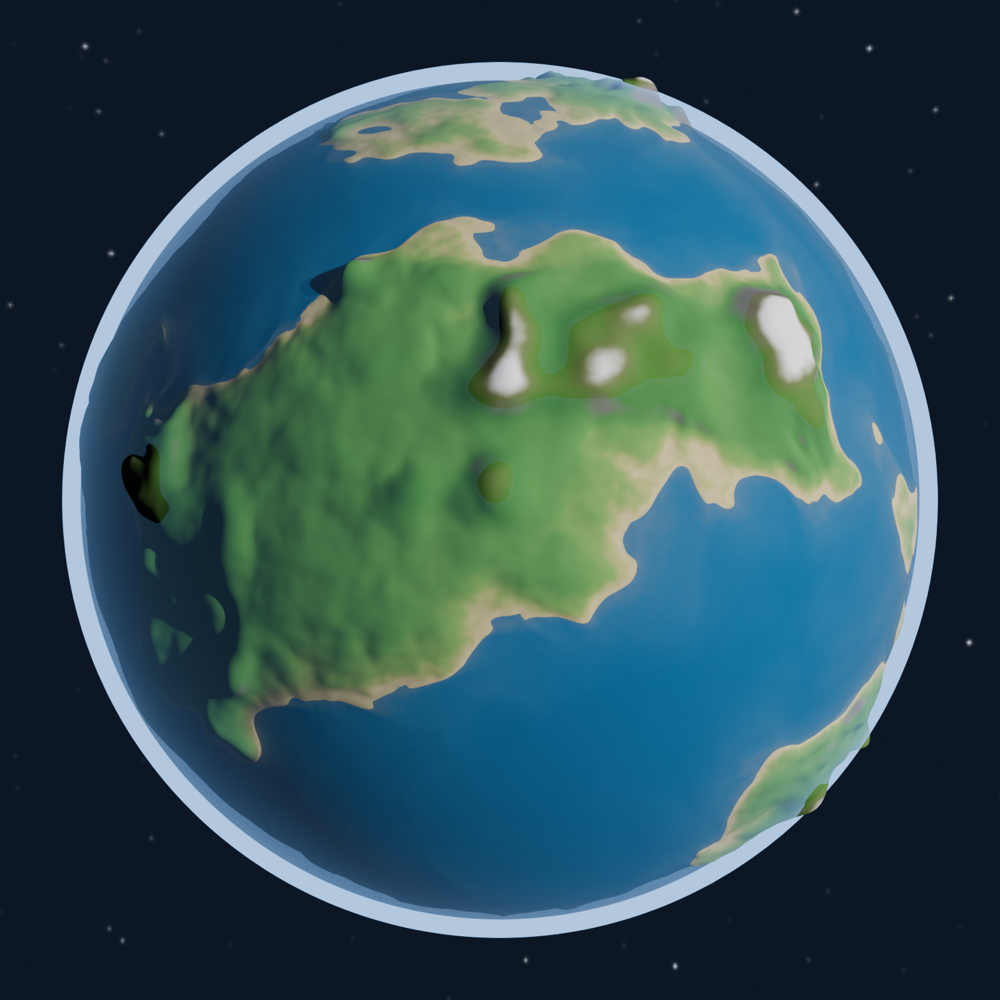
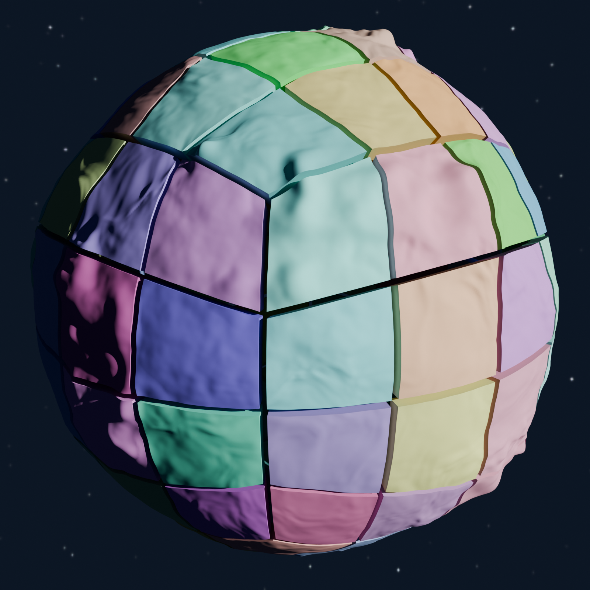
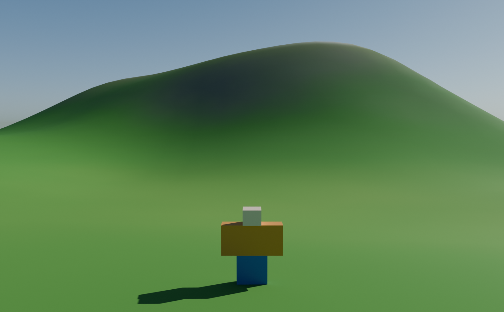
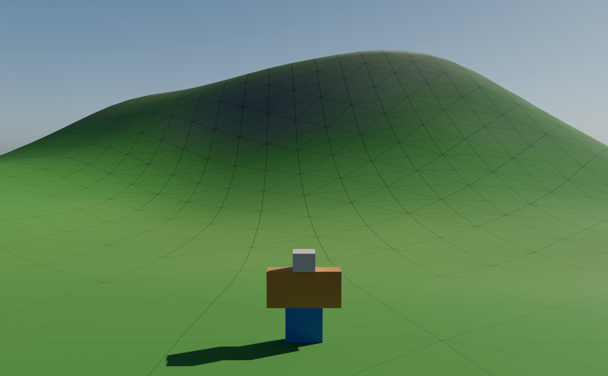

# Planeta de prueba (hecho en Blender, no con Terrain)

Experimento: una esfera de **radio 2400 studs** con relieve suave (colinas, montañas y valles, sin escalones), partida en
`MeshPart`s que cumplen los límites de Roblox, con una textura de colores por altura (playa, hierba, roca y nieve) y un
script de Luau que la coloca con colisión precisa. Todo sale de scripts de Python en Blender sin pantalla (`bpy`).

> **Importante: esto NO se ha visto en Roblox Studio.** Esta sesión no tiene Studio. Lo que sí está comprobado, y lo que no,
> se detalla en [«Qué se ha comprobado y qué no»](#qué-se-ha-comprobado-y-qué-no). Según CLAUDE.md, el director tiene que
> probarlo en Studio (con capturas) antes de darlo por bueno.

## Imágenes

Todas se renderizan **reimportando los 96 FBX exportados** (no los datos en memoria), así que comprueban también la
exportación. El mar y la atmósfera de los renders son de referencia: **no se exportan**.

| | |
| --- | --- |
|  |  |
| El planeta entero, desde el espacio (Sol a 55° de la cámara: se ve el terminador) | Despiece: los 96 trozos, cada uno de un color y separado 150 studs del centro (se ve que son sólidos cerrados) |
|  |  |
| Primer plano de la superficie con un maniquí R6 (5 studs) como escala | La misma vista con las aristas de los triángulos: miden ~14 studs |

## Resumen

| | |
| --- | --- |
| Radio (nivel del mar) | 2400 studs |
| Altura del relieve | de −93 (fondo marino) a +158 studs (cumbres). 35 % de la superficie es tierra |
| Pendiente en tierra | mediana 9°; el 55 % está por debajo de 10°, el 90 % por debajo de 25°, el 99 % por debajo de 41° |
| Trozos | **96** = 6 caras de un cubo × 4 × 4, cada uno un sólido cerrado (superficie + fondo + 4 paredes) |
| Triángulos | **8.608 por trozo** (límite 20.000), 826.368 en total |
| Tamaño de cada trozo | como mucho **1.043 studs** por eje (límite que cuentan los foros: 2.048) |
| Resolución | cuadros de ~14 studs de lado (el 90 % entre 11 y 15; el máximo, 27) |
| Textura | una sola paleta de 256 × 256 (altura × pendiente), compartida por los 96 trozos |
| Peso | 96 FBX, 29 MB |

## Límites de MeshPart: qué dice la documentación

Lo pedido era comprobarlos en la documentación oficial. **El de triángulos es oficial; el de tamaño no lo he encontrado en
ninguna página oficial**, solo en el DevForum. Se dice claramente para no darlo por seguro.

| Límite | Valor | Fuente | Estado |
| --- | --- | --- | --- |
| Triángulos por malla | **20.000** | [Especificaciones de mallas](https://create.roblox.com/docs/art/modeling/specifications): «Individual meshes can not exceed 20,000 triangles» | Oficial |
| Tamaño por eje | **2.048 studs** | Mensajes de usuarios en el DevForum ([ejemplo](https://devforum.roblox.com/t/cant-change-the-size-of-mesh-above-the-roblox-limit/2176150), [otro](https://devforum.roblox.com/t/support-for-limitless-mesh-imports-size-and-import-raw-collision-data/2836449)); ninguna respuesta del personal de Roblox | **No oficial.** Las páginas de BasePart, MeshPart, Parts y Meshes del Creator Hub que he podido leer no dan un máximo. Se usa como si fuera cierto y se deja margen: el mayor trozo mide un 51 % del límite |
| Colisión «Precise» | sin cifras | [Colisiones](https://create.roblox.com/docs/workspace/collisions): `PreciseConvexDecomposition` es la de más fidelidad, pero «still not a 1:1 representation of the visual», y la más cara de calcular | Oficial, sin números. Los foros dicen que el error de la aproximación crece con el tamaño de la malla (anecdótico). **Es el mayor riesgo de este experimento** |
| Textura | hasta 4096 × 4096 | [Texturas](https://create.roblox.com/docs/art/modeling/texture-specifications): la misma página dice también «up to 1024×1024 pixel spaces for texture maps» | Contradictorio en la propia documentación. La paleta mide 256 × 256: cumple las dos |
| Escala del importador | **Stud** por defecto | [Importador](https://create.roblox.com/docs/studio/importer) y [guía de Blender](https://create.roblox.com/docs/art/blender): Unit System «None», «FBX Unit Scale», delante Z, arriba Y; en el importador, Scale Unit = Stud | Oficial. Con unidades distintas de Stud, el anuncio del [DevForum](https://devforum.roblox.com/t/more-control-over-importer-custom-scale-factor-and-updated-unit-conversions/4644371) habla de una conversión 25:7 y de un campo «Custom Scale Factor» |

## Cómo está hecho

1. **El relieve es una función** (`herramientas/terreno.py`), no una malla esculpida: dada una dirección, devuelve la altura.
   Capas suaves: continentes (ruido de baja frecuencia con la dirección deformada), colinas, cordilleras (ruido «de
   crestas» suavizado) y valles (surcos en los cruces por cero de otro ruido). Como cada vértice pide su altura a la
   función, dos trozos vecinos dan **exactamente** la misma altura en su borde: no hay costuras.
2. **Cubo-esfera con reparto de ángulos iguales**: los cuadros miden casi lo mismo en todo el planeta (sin los polos
   pellizcados de una esfera UV). Los bordes entre caras del cubo se calculan con la misma operación en las dos caras:
   el hueco medido es 0.
3. **Normales exactas**: se derivan del propio relieve (diferencias centradas de 1 stud), no de la malla. El sombreado es
   liso y es idéntico a los dos lados de cada borde entre trozos.
4. **Cada trozo es un sólido cerrado**: superficie con relieve, fondo grueso (esfera de radio 2200, muy por debajo del
   fondo marino más hondo) y cuatro paredes. La colisión `PreciseConvexDecomposition` trabaja con volúmenes; una lámina
   sin grosor se atraviesa con más facilidad.
5. **Textura por altura y pendiente**: la paleta de 256 × 256 tiene la altura en horizontal (playa, hierba, monte, tundra,
   roca y nieve) y la pendiente en vertical (la roca asoma en las laderas empinadas y la nieve se cae de ellas). Cada vértice
   lleva como UV el punto de la paleta que le corresponde, con un ruido pequeño para romper las curvas de nivel. Como la UV
   se interpola por píxel, las transiciones salen nítidas aunque los triángulos midan 14 studs.
6. **FBX por trozo**, con el nombre (`Planeta_XP_0_0`...) y la posición del trozo guardados en el propio FBX, siguiendo la
   receta oficial. Sin textura incrustada: la paleta se sube una vez y la pone el script.

## Importar en Studio, paso a paso

Antes: un lugar vacío (quita el Baseplate) y, recomendado, `Workspace.StreamingEnabled = true`.

1. **Sube la paleta (una vez).** `View → Asset Manager → Images → Bulk Import` con `paleta_color.png`; en el Asset Manager,
   clic derecho sobre la imagen → *Copy Asset ID*. Si luego los trozos salen sin color, es que has copiado el ID del *decal*
   y no el de la imagen. Si salen con los colores del revés (llanuras grises y laderas verdes), Studio invierte la V:
   sube `paleta_color_v_invertida.png` en su lugar.
2. **Importa los 96 FBX de `piezas/`.** Con *Import 3D* (en la pestaña Avatar o Home, según la versión de Studio); si no deja
   elegir varios archivos, `Asset Manager → Bulk Import`. Ajustes del importador, los de la guía oficial de Blender:
   - *File Geometry → Scale Unit*: **Stud**. *Custom Scale Factor*: 1.
   - *File Transform → World Forward*: **Front**; *World Up*: **Top**.
   - *Import Only As Model*: activado.
3. **Pega el ID en el script.** Abre `colocar_planeta.luau` y pon el ID en `AJUSTES.IdPaleta` (`"rbxassetid://123..."`).
4. **Ejecútalo.** Selecciona lo que ha creado el importador (o nada: busca en todo `Workspace`), abre `View → Command Bar`,
   pega el script entero (50 KB) y pulsa Enter. Si la barra no deja pegar tanto, guárdalo como `ModuleScript` en
   `ServerStorage` y ejecuta `require(game.ServerStorage.ColocarPlaneta)` en la barra.
5. **Lee la salida.** El script:
   - comprueba que cada malla tiene el **tamaño esperado** (si el importador usó otra escala, dice qué poner);
   - las ancla, les pone `CollisionFidelity = PreciseConvexDecomposition`, `RenderFidelity = Precise` y la textura, y las
     mete en un `Model` llamado `PlanetaPrueba`;
   - **mide la colisión**: lanza 480 rayos desde fuera del planeta (240 al azar y 240 sobre los bordes entre trozos) y los
     compara con el radio de la superficie triangulada. Si no hay un giro fijado, prueba 0° y 180° (por si el importador
     gira cada trozo) y se queda con el mejor;
   - imprime `CORRECTO` o `REVISAR`, con el error medio, el p95 y el máximo en studs.
6. **Guarda el lugar** (`File → Save`) para conservar la colisión ya calculada.

Se puede volver a ejecutar: reutiliza el `Model` en vez de destruirlo (destruirlo destruiría también las mallas).

### Si la comprobación falla

| Síntoma | Causa probable | Qué hacer |
| --- | --- | --- |
| «N trozos NO tienen el tamaño esperado… X veces el esperado» | El importador usó otra escala (con la unidad *Meter* sale ×3,571) | *Scale Unit* = Stud, o *Custom Scale Factor* = el valor que indica el aviso; vuelve a importar |
| «faltan N trozos» | No se han importado los 96 | Importa los que falten |
| `0/480 rayos con impacto` | La colisión aún no estaba calculada, o las mallas no están en `Workspace` | Sube `AJUSTES.EsperaFisica` y vuelve a ejecutar |
| Con ningún giro baja el error (decenas o cientos de studs) | El importador gira o refleja los trozos de otra forma | Prueba otras combinaciones de *World Forward / World Up* y cuéntalo: hay que ajustar el eje de exportación en `planeta_prueba.py` (`exportar_fbx`) |
| El giro es bueno pero el error máximo pasa de 4 studs | La colisión Precise no sigue bien la malla (el riesgo de arriba) | Regenera con trozos más pequeños (`--lado 6` u `8`, ver la tabla de abajo) o prueba `CollisionFidelity.Default` |
| Se ven grietas entre trozos | `RenderFidelity` en Automatic (simplifica cada trozo a su manera) | El script ya lo pone en Precise; comprueba que no lo has cambiado |

## Qué se ha comprobado y qué no

**Comprobado aquí:**

- Los 96 FBX se reimportan en Blender con la posición guardada: error de posición 0,0001 studs y de tamaño 0,0005.
- **Costuras:** en una muestra de 1 de cada 6 vértices, 4.856 pares de vértices gemelos entre trozos vecinos, separados como mucho 0,00035 studs (redondeo de float32).
- Normales por esquina, unitarias. El hueco entre caras del cubo, calculado en doble precisión, es 0.
- **Lo que guarda el FBX**, leído del propio archivo con `herramientas/leer_fbx.py`: unidad = metros (`UnitScaleFactor` 100)
  con los vértices en unidades de Blender sin convertir (un trozo de ±463 va como ±463: con *Scale Unit = Stud* son studs);
  eje arriba +Y; la traslación del objeto coincide con la tabla de datos (462,939; 2152,374; −455,965) y su rotación
  (90°, 0°, 180°) equivale a la conversión `(x, y, z) → (−x, z, y)`.
- El script de Luau **compila** y se ha **ejecutado en un simulador** (`pruebas/casos/PlanetaPrueba.luau`, 15 pruebas):
  colocación, ajustes de cada pieza, detección del giro, aviso de escala, trozos que faltan, doble ejecución. Se ha
  verificado que las pruebas fallan si se reintroducen dos errores del script (destruir el modelo al repetir; no elegir el
  mejor giro).

**NO comprobado (hace falta Studio):**

- Que el importador de Roblox respete la rotación de cada FBX al importar los trozos por separado (por eso el script
  prueba 0° y 180° y mide).
- La **colisión precisa**: lo que cuesta calcularla, lo bien que sigue la malla (un trozo de 942 studs de lado tiene una
  flecha de 46 studs por la curvatura) y cómo se comporta un personaje caminando por ella.
- El rendimiento de 826.368 triángulos, sobre todo en móvil.
- Si Studio invierte la V de la paleta (hay un PNG de reserva).
- **Tipado estricto del script de Luau** (`--!strict`): intenté descargar el analizador de Luau, pero el entorno denegó
  ejecutar un binario externo que no está entre las herramientas del proyecto (`rokit.toml`), así que solo se ha comprobado
  que compila y que funciona en el simulador, no el análisis de tipos de `luau-lsp`/`selene`.

## Qué ha enseñado el experimento (para el diseño del juego)

1. **El planeta se curva mucho.** Con radio 2400, el horizonte de un jugador con los ojos a 5 studs está a **155 studs**
   (a 20 studs de altura, 310). Lo que está a 500 studs queda 52 studs por debajo del plano de los ojos: una cumbre de 150
   studs queda oculta por la curvatura a unos 1.000 studs. CLAUDE.md pide planetas «enormes»: con este radio se ve pequeño y esférico desde el suelo.
2. **Liso, sí; pero sin detalle.** La paleta da color y el sombreado es continuo, pero a ras de suelo no hay nada más que
   degradados (mira el primer plano). Hace falta una capa de detalle: texturas repetidas, decals, vegetación, rocas sueltas.
3. **La resolución de la malla es de ~14 studs por cuadro**, casi tres personajes. Cualquier forma menor (un camino, un
   escalón, un charco) tiene que venir de piezas aparte. Se podría usar más resolución cerca del aterrizaje y menos lejos.
4. **Una malla no se puede cavar ni construir encima como Terrain.** Si el diseño necesita modificar el suelo, esto no vale.
5. **El mar no se exporta.** Los fondos marinos de la paleta (azul oscuro) son cuencas secas en esta prueba. Un mar en Roblox
   sería otra esfera translúcida, también en trozos, con la misma técnica.
6. **Peso:** 826.368 triángulos en 96 mallas. Habría que medirlo, y estudiar LOD o `StreamingEnabled` con cuidado.

## Regenerar

Requiere Python 3.13 y `herramientas/requirements.txt` (`bpy`, `numpy`, `pillow`):

```bash
python3 -m venv .venv && .venv/bin/pip install -r modelos/planeta_prueba/herramientas/requirements.txt
.venv/bin/python modelos/planeta_prueba/herramientas/planeta_prueba.py --salida modelos/planeta_prueba
.venv/bin/python modelos/planeta_prueba/herramientas/planeta_render.py --salida modelos/planeta_prueba
.venv/bin/python modelos/planeta_prueba/herramientas/leer_fbx.py modelos/planeta_prueba/piezas/Planeta_XP_0_0.fbx
lune run pruebas/ejecutar "Planeta de prueba"
```

`planeta_prueba.py` falla si algún trozo pasa de 20.000 triángulos o de 2.048 studs. Parámetros: `--lado K` (trozos por lado de
cada cara; 6·K² en total), `--cuadros N` (múltiplo de 8), `--semilla`, `--rapido` (resolución mínima) y `--sin-fbx`. El relieve
y la paleta se ajustan arriba del todo de `terreno.py` y `planeta_prueba.py`.

| `--lado` | `--cuadros` | Trozos | Triángulos por trozo | Cuadro | Flecha del trozo* | Total |
| --- | --- | --- | --- | --- | --- | --- |
| 3 | 96 | 54 | 19.152 | ~13 studs | 82 studs | 1,03 M |
| **4** | **64** (por defecto) | **96** | **8.608** | **~14 studs** | **46 studs** | **0,83 M** |
| 4 | 48 | 96 | 4.896 | ~20 studs | 46 studs | 0,47 M |
| 6 | 32 | 216 | 2.224 | ~20 studs | 21 studs | 0,48 M |
| 8 | 24 | 384 | 1.278 | ~20 studs | 12 studs | 0,49 M |

\* Lo que se aparta el centro del trozo de su plano tangente por la curvatura. Si la colisión precisa no es lo bastante
precisa, trocear más (más abajo en la tabla) reduce ese número, a costa de más piezas.

## Archivos

| Archivo | Qué es |
| --- | --- |
| `piezas/Planeta_<cara>_<i>_<j>.fbx` | Los 96 trozos. `<cara>` es XP, XN, YP, YN, ZP o ZN (la normal del cubo, en ejes de Roblox) |
| `paleta_color.png` | La textura de colores por altura (horizontal) y pendiente (vertical, el llano abajo) |
| `paleta_color_v_invertida.png` | La misma, invertida en vertical, por si Studio invierte la V |
| `colocar_planeta.luau` | Script de Luau para la barra de comandos (generado: no se edita a mano) |
| `datos_piezas.json` | Nombre, posición, tamaño y triángulos de cada trozo; parámetros y estadísticas del relieve; las 480 muestras de colisión |
| `render_*.png` | Las imágenes de arriba |
| `herramientas/terreno.py` | El relieve (solo numpy) |
| `herramientas/planeta_prueba.py` | Cubo-esfera, trozos, paleta, exportación FBX, datos y script de Luau |
| `herramientas/plantilla_colocar_planeta.luau` | Plantilla del script de Studio: aquí se retoca la lógica |
| `herramientas/planeta_render.py` | Reimporta los FBX, comprueba la ida y vuelta y renderiza |
| `herramientas/leer_fbx.py` | Lector mínimo de FBX binario, para ver lo que guarda de verdad un archivo |
| `pruebas/casos/PlanetaPrueba.luau` | Pruebas de los datos y del script de Luau (parte de `lune run pruebas/ejecutar`) |
