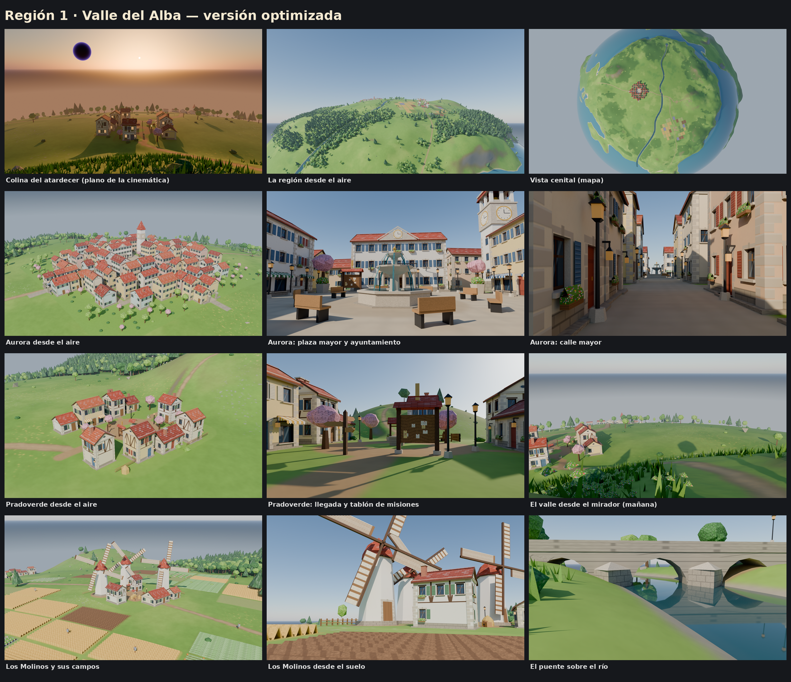
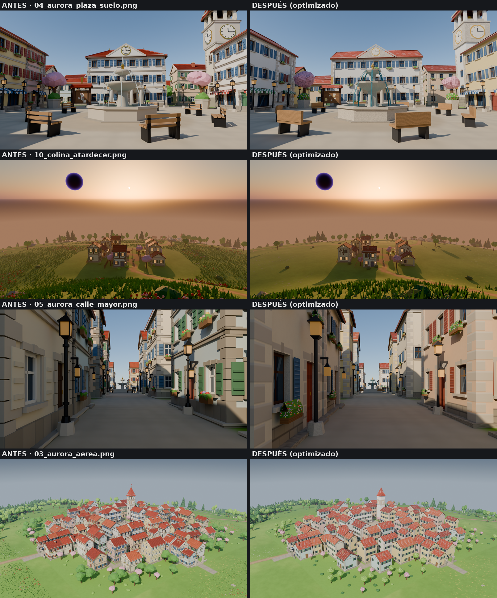
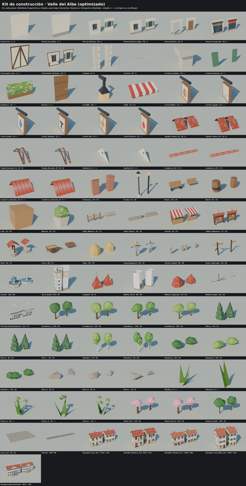

# Región 1 · Valle del Alba (planeta humano Nueva Tierra)

La región inicial del planeta humano. Es la más tranquila: praderas, un río que cruza el valle, bosques suaves,
colinas y una colina con vistas al atardecer. Tiene tres sitios: **Pradoverde** (el pueblo inicial), **Aurora** (la
capital) y **Los Molinos**.

Esta es la **segunda versión, optimizada para móvil**. El diseño (relieve, trazado de los pueblos, estilo) es el
de la primera; lo que cambia es cómo está hecho por dentro, para que pese muchísimo menos y Roblox pueda reutilizar
las piezas. Ver [«Optimización para móvil»](#optimización-para-móvil).

> **Nada de esto se ha visto todavía en Roblox Studio.** Esta sesión no tiene Studio. Está preparado para
> importarlo (piezas en FBX, listas de posiciones, scripts de montaje y de LOD), pero según CLAUDE.md el director
> tiene que probarlo en Studio, con capturas, antes de darlo por bueno. Ver
> [«Qué se ha comprobado y qué no»](#qué-se-ha-comprobado-y-qué-no).



## Optimización para móvil

### Triángulos: antes y después

**Lo que se dibuja desde cada vista** (los triángulos de todo lo que cae dentro del campo de visión de la cámara,
con el nivel de detalle que toca a cada distancia; medido con `herramientas/medir.py` sobre las dos escenas):

| Vista | Antes | Después | Se divide entre |
| --- | ---: | ---: | ---: |
| **Plaza de Aurora**, a la altura de una persona (`04`) | 3.885.668 | 302.448 | **12,8** |
| **Colina del atardecer**, el plano de la cinemática (`10`) | 5.187.971 | 264.084 | **19,6** |
| Aurora desde el aire (`03`) | 4.540.568 | 314.030 | 14,5 |
| La región entera desde el aire (`01`) | 8.071.081 | 222.308 | 36,3 |

Desglose de las dos vistas principales:

| | Plaza: antes | Plaza: después | Colina: antes | Colina: después |
| --- | ---: | ---: | ---: | ---: |
| Terreno | 2.097.152 | 163.200 | 2.097.152 | 185.600 |
| Edificios (con la torre, la fuente y los molinos) | 405.675 | 29.948 | 949.781 | 3.516 |
| Mobiliario | 38.027 | 4.856 | 105.486 | 2.952 |
| Vegetación (árboles, arbustos, rocas, hierba) | 1.335.774 | 95.404 | 1.999.840 | 63.024 |
| Campos y agua | 9.040 | 9.040 | 35.712 | 8.992 |

**Por edificio:**

| | Antes | Después: detallado | Después: simple (lejos) |
| --- | ---: | ---: | ---: |
| Casa de Aurora (media de 72) | 12.254 | 1.345 (de 796 a 3.071, el ayuntamiento) | 187 |
| Casa de Pradoverde (media de 9) | 7.496 | 796 | 130 |
| Casa de Los Molinos (media de 4) | 8.181 | 869 | 130 |
| Casa de ejemplo de 3 × 2 módulos, 2 pisos | 11.578 | 1.118 | 154 |
| Ayuntamiento | 23.028 | 3.071 | 365 |
| Torre del reloj (con el chapitel) | 9.420 | 674 | 46 |
| Fuente de la plaza | 1.182 | 530 | 86 |
| Árbol frondoso | 364 | 130 | 26 |

**La región entera** (si se dibujara todo en su versión detallada, sin LOD ni recorte):

| | Antes | Después |
| --- | ---: | ---: |
| Total | 8.098.477 | 2.771.798 |
| Edificios | 982.505 | 107.450 |
| Terreno | 2.097.152 (una malla) | 1.228.800 (64 trozos; los simples suman 40.960) |
| Mallas distintas de edificios y mobiliario (lo que hay que guardar y subir) | 1.013.613 (cada edificio era una malla única) | **5.595** (las 85 piezas del kit, detalladas y simples) |
| Texturas | 1 de 4096² para el terreno | 1 atlas de 1024² para todo el kit, 16 de 1024² para el terreno cercano y 1 de 1024² para el lejano |

La versión detallada del terreno pesa casi lo mismo que antes (los trozos tienen cuadros de 4,9 studs para que las
colinas sigan suaves), pero solo se dibujan detallados los trozos cercanos: desde la plaza, 8 de 64.

### Qué se ha hecho

1. **El detalle pequeño, a la textura.** Tejas, juntas, sillares, marcos, lamas de las contraventanas, tablas,
   papeles del tablón, la celosía de las aspas, el emblema de los carteles... van pintados en un **atlas de
   1024 × 1024** (`texturas/atlas_kit.png`, 64 casillas, `herramientas/atlas.py`). La geometría conserva solo lo que
   da volumen de verdad: el hueco de ventanas y puertas (con su fondo), los alféizares, los aleros, las cornisas y
   las esquinas de sillar. Una pared con ventana tiene 28 triángulos y un tramo de tejado, 16.
2. **Una pieza, todos los colores.** En el atlas, las superficies que cambian de color (yeso, tejas,
   contraventanas, puertas, toldos) son **transparentes**: se ve el color de la copia (en Roblox, `MeshPart.Color`).
   Por eso las contraventanas, la puerta o el toldo son piezas aparte: cada una lleva su color.
3. **Los edificios ya no son mallas únicas: son listas de piezas.** Cada pieza del kit se exporta **una vez** y cada
   edificio guarda dónde va cada copia (posición, giro, escala y color). Los 85 edificios usan 41 piezas distintas
   (7.858 copias en total, unas 98 por casa de Aurora). Nada se coloca con espejo: en Roblox un CFrame no puede reflejar, así
   que el lado derecho de un tejado o de un hastial es la misma pieza girada 180°.
4. **Dos versiones de cada pieza.** Detallada y simple. En la simple, la pared con ventana es un solo cuadro con
   la ventana y las contraventanas pintadas (2 triángulos), el tejado pierde los aleros, el árbol se queda con una
   copa, y las piezas pequeñas (contraventanas, jardineras, carteles, matas de hierba) de lejos no se dibujan.
5. **Terreno en 8 × 8 trozos** de unos 470 studs, cada uno en versión detallada (19.200 triángulos, por debajo del
   límite de 20.000 por malla) y simple (640), con un **faldón** de 8 studs en el borde que tapa las grietas entre
   trozos de distinto detalle. Las normales son las exactas del relieve, así que no se ve la junta entre trozos.
6. **Silueta de Aurora**: toda la capital en **una malla de 1.020 triángulos** (cajas con fachada pintada y tejado
   a dos aguas, y la torre), con casillas opacas del atlas. Sustituye a los 72 edificios más allá de 700 studs.
7. **Niveles de detalle por distancia** (`diseno.LOD`, en studs):

   | | Detallado hasta | Simple hasta | Más allá |
   | --- | ---: | ---: | --- |
   | Edificios (y torre, fuente, molinos, portales) | 220 | 2.600 | no se dibuja |
   | Mobiliario | 140 | 500 | no se dibuja |
   | Árboles | 160 | 3.000 | no se dibuja |
   | Arbustos y rocas | 160 | 1.100 | no se dibuja |
   | Matas de hierba y flores | 110 | — | no se dibuja |
   | Terreno | 650 | siempre | — |
   | Aurora | | | silueta a partir de 700 |

8. **Recorte por el horizonte.** Con radio 2400 la curvatura tapa muchísimo: a ras de suelo el horizonte está a unos
   155 studs. Lo que queda entero por debajo del horizonte no se dibuja (el ángulo entre la cámara y el objeto
   tiene que ser menor que la suma de los ángulos de horizonte de los dos). No se pierde nada que se viera: el propio
   planeta lo tapaba.
9. **Física barata.** En Roblox las piezas no chocan (`CanCollide`, `CanQuery` y `CanTouch` apagados) y cada
   edificio lleva una sola caja de colisión invisible. Las piezas pequeñas no proyectan sombra.

### Lo que se ha perdido (y por qué)

- **Hierba a media distancia.** Las matas de hierba y flores solo se dibujan hasta 110 studs. En las vistas desde el
  aire o desde la colina la pradera se ve más lisa que antes (compara los renders `06` y `11` con los de `antes/`).
  Si se quiere recuperar, se sube `LOD["hierba"]` (cada mata son 6 triángulos).
- **Profundidad de las tejas.** Antes cada hilada era un escalón de geometría; ahora es dibujo. De cerca se nota un
  poco en los aleros; de lejos no.
- **Más objetos.** Antes eran 85 mallas de edificios; ahora son 7.858 copias de piezas en los edificios (8.223 con el
  mobiliario). Roblox junta las copias de una
  misma malla para dibujarlas, y el script de LOD solo deja en el mundo lo cercano, pero el número de instancias es
  un coste nuevo (memoria y tiempo de carga) que hay que medir en Studio. Si pesara demasiado, se pueden unir
  algunas piezas de cada edificio (por ejemplo las paredes de un piso) sin cambiar el resto.

### Comparación de renders

`renders/antes/` tiene los renders de la primera versión con los mismos encuadres; `renders/comparacion_*.png` los
pone lado a lado.



## Dónde está y cómo se apoya en el planeta de prueba

- Usa la geometría de `modelos/planeta_prueba` (rama `feat/planeta-prueba`, PR #15): una esfera de **radio 2400
  studs** partida como un cubo inflado con reparto de ángulos iguales. La región 1 es la cara **YP** (la normal +Y
  de Roblox, que en Blender es +Z). La cara mide unos **3.770 × 3.770 studs** sobre la esfera.
- El relieve es una **función** (`herramientas/relieve.py`): cualquier malla (la de los renders o los trozos para
  Roblox) pide la altura a la función y sale el mismo terreno.
- **Empalme con el resto del planeta:** en los últimos 420 studs de la cara el valle se funde con el relieve del
  planeta de prueba (copiado tal cual en `herramientas/terreno_base.py`), con derivada nula en el borde.
- **Decisión pendiente de validar:** en el planeta de prueba la cara YP es casi toda mar, así que el valle está
  rodeado por una sierra de colinas y, al otro lado, la costa y el mar del planeta de prueba (con tierra hacia el
  oeste y el sur, por donde salen los caminos a otras regiones).

## Contenido

| | Qué hay |
| --- | --- |
| **Terreno** | Praderas onduladas, sierra de colinas con pasos para el río y los caminos, 8 colinas sueltas y la **colina del atardecer** (88 studs). Sin escalones: la mediana de la pendiente en tierra es de 9° |
| **Río** | Nace en una charca entre las colinas del norte, cruza el valle con meandros (de 14 a 48 studs de ancho) y sale al mar por el suroeste |
| **Pradoverde** (120 × 120) | Al pie de la colina del atardecer: prado con pozo, **tablón de misiones**, poste indicador, la **casa del jugador** (puerta y contraventanas azules, jardín vallado), la **tienda** y 7 casas rústicas con entramado |
| **Aurora** (400 × 400) | **Plaza mayor** con **fuente**, bancos, cerezos, mercado y **tablón de misiones**; **ayuntamiento**; **torre del reloj** de 92 studs; **6 tiendas** con escaparate, toldo y cartel (general, armería, materiales, pociones, taller de naves, panadería); calle mayor, avenidas, calles secundarias y ronda; 72 edificios de tejado rojo |
| **Los Molinos** (120 × 120) | **3 molinos** de viento, era, pozo, tablón de misiones, casas de labor; **42 parcelas** de cultivo alrededor |
| **Caminos y puente** | Aurora → **puente de piedra** (83 studs, tres ojos) → cruce → Pradoverde; cruce → Los Molinos; sendero al mirador; salidas al oeste y al sur |
| **Mirador** | Una terraza a media ladera de la colina del atardecer, mirando al oeste: desde la cima no se ve el valle por la curvatura |
| **Vegetación** | 15.609 árboles, 2.189 arbustos, 621 rocas y 20.837 matas de hierba y flores |

## El kit de construcción



`kit_valle_del_alba.blend` tiene las 85 piezas (cada una con su versión simple al lado) ordenadas por categorías, y
5 edificios de ejemplo montados con **copias** de las piezas, como en la región. La hoja muestra cada pieza
detallada (izquierda) y simple (derecha) con sus triángulos.

- **Medidas** (`kit.py`, `MEDIDAS`): tramo de pared de 8 studs, pisos de 10, puerta de 4 × 7,4 (un R6 mide 5),
  tejado de ~32°.
- **Paredes:** x ∈ [0, 8] a lo largo de la pared, cara exterior en y = 0 mirando a −Y, z ∈ [0, 10]. Las caras de
  dentro no existen (no se ven nunca).
- **Colores** (`edificios.py`, `COLORES`): cada edificio elige el yeso (6), las tejas (3), las contraventanas (4),
  la puerta (5) y el toldo (4). Con las mismas piezas sale toda la variedad.

## Para Roblox (preparado, sin probar)

Todo lo necesario está en `roblox/`; lo genera `herramientas/exportar.py` a partir del .blend:

| Archivo | Qué es |
| --- | --- |
| `roblox/piezas/<Pieza>.fbx` y `<Pieza>__lejos.fbx` | Cada pieza del kit **una sola vez** (86 detalladas, 51 simples) |
| `roblox/terreno/Terreno_<f>_<c>[__lejos].fbx` | Los 64 trozos de terreno, detallados y simples |
| `roblox/silueta/Aurora_Silueta.fbx` | La silueta de Aurora |
| `roblox/datos/piezas.json` | Tamaño, centro de la caja, triángulos y color por defecto de cada pieza |
| `roblox/datos/edificios_<Sitio>.json` | Cada edificio: su CFrame, su caja de colisión y la **lista de sus piezas** (pieza, CFrame relativo, escala, color) |
| `roblox/datos/objetos_<Sitio>.json` | Lo mismo para el mobiliario, los molinos, la torre, la fuente, el puente... |
| `roblox/datos/terreno.json`, `silueta_Aurora.json` | Posición, radio y textura de cada trozo; la silueta |
| `roblox/datos/vegetacion/<f>_<c>.json` | Árboles, arbustos, rocas y matas, repartidos por trozo de terreno |
| `roblox/datos/lod.json` | Las distancias de los niveles de detalle |
| `roblox/MontarRegion.luau` | Monta la región en el lugar (en Studio, una vez): edificios y objetos con copias de las piezas, terreno detallado con colisión precisa, cajas de colisión y la silueta |
| `roblox/LodRegion.luau` | En el cliente: cambia cada cosa entre detallada, simple y nada según la distancia y el horizonte, cambia Aurora por su silueta y crea la vegetación por trozos solo cerca de la cámara |
| `roblox/EjemploArranque.luau` | Ejemplo de cómo se llaman los dos (estructura esperada en `ReplicatedStorage`) |
| `texturas/atlas_kit.png` | El atlas (una sola subida, para todas las piezas) |
| `texturas/terreno_<f>_<c>.png`, `terreno_lejos.png` | Las 16 texturas del terreno cercano (cada una cubre 2 × 2 trozos) y la del lejano |

Coordenadas de Roblox (Y arriba, studs). Los FBX se exportan con la receta oficial de Blender para Roblox («Apply
Transform», −Z delante, Y arriba, studs). Un CFrame se guarda como sus 12 números. Roblox centra cada malla
importada en su caja; por eso cada pieza guarda su «centro» y el script lo compensa.

Pasos previstos (sin probar): importar `roblox/piezas`, `roblox/terreno` y la silueta con *Scale Unit = Stud*;
subir el atlas y las 17 texturas de terreno; poner las MeshPart y los datos en `ReplicatedStorage.Region1` (los .json
los puede sincronizar Rojo, que convierte cada uno en un ModuleScript); ejecutar
`EjemploArranque.montarEnStudio(idAtlas, idsTerreno)` y guardar el lugar; arrancar `EjemploArranque.iniciarCliente()`
desde un LocalScript.

## Probado en Studio (director, 4-11-2026)

Montada sobre el planeta redondo del experimento (Nueva Tierra, centro en (-35000, 0, 0)), rama local
`prueba/region1-valle-alba`. Lo que se encontró y se arregló:

- **El color de las piezas NO se ve a través del atlas con `TextureID`**: Roblox pinta el ruido de color que hay detrás
  de las zonas transparentes (paredes moteadas, tejados grises). Con un `SurfaceAppearance` en cada plantilla
  (`ColorMap` = atlas, `AlphaMode = Overlay`) sí: tejados rojos y yeso liso del color de cada copia.
  Se hace una vez en Studio con `EjemploArranque.prepararPiezasEnStudio(idAtlas)`. Coste: unos 80 MB más (8.224
  instancias de `SurfaceAppearance`).
- **Todas las mallas entran giradas 180° sobre su eje vertical** (terreno y piezas; la silueta está por revisar). Sin
  girarlas quedan huecos de decenas de studs entre trozos de terreno, y cada pared mira hacia DENTRO: desde fuera se
  ve su cara trasera (nada: «láminas transparentes») y el interior de la pared de enfrente.
  `MontarRegion.GIRO_IMPORTACION`.
- **Paredes y hastiales con grosor** (0,6 studs, cara interior; jambas de todo el grosor), puerta y contraventanas
  cerradas, cumbreras con tapas y panza en los tejados de lejos (`herramientas/kit.py`). Antes eran una sola cara y
  desde dentro de los edificios o de canto no se veían. `DoubleSided` solo en el toldo (`kit.DOBLE_CARA`). Coste:
  edificios y mobiliario +30 % si todo se dibujara en detalle (unos 9.000 triángulos más en la vista de la plaza).
  Se rehízo solo lo afectado con `herramientas/rehacer_piezas.py` (23 FBX) y se comprueba con `revisar_caras.py`.
  `kit_valle_del_alba.blend` (la hoja del kit) no se ha regenerado.
- Con el giro, la **colisión precisa** de los trozos es buena: en la base de 84 edificios el rayo choca a menos de
  0,4 studs de la altura real.
- Los **trozos lejanos** no tenían textura (`LodRegion` no se la ponía): ahora sí (`iniciarCliente` recibe los IDs).
- Los scripts suponían el planeta en el origen: opción `Origen` (marco del centro del planeta).
- Dos errores de tipos en `LodRegion` (luau-lsp): arreglados; los tres scripts pasan `luau-lsp analyze` y selene.
- El importador respeta la escala en studs y los ejes de las piezas (los tamaños coinciden con los datos).
- El LOD funciona: desde la plaza ~7.200 piezas detalladas; a 420 studs de Aurora ~5.300 simples y sin silueta; a
  1.150 studs, la silueta de Aurora (y encaja con los edificios).

Coste medido (Studio en PC, limitado a 15 FPS en este equipo, así que se mide el tiempo de render en CPU): de 8 a 9 ms
por fotograma en las tres vistas, frente a 3,6 ms mirando al espacio vacío; la lógica (LOD y vegetación), de 1,0 a
1,3 ms frente a 0,4. Montar la región: 0,5 s, unas 9.300 instancias más (+156 MB con los `SurfaceAppearance`). La
vegetación local suma de 12.000 a 16.000 instancias más según la vista: es lo que más pesa.

## Qué se ha comprobado y qué no

**Comprobado aquí:**

- Las posiciones de la lista: para las **8.223 piezas** colocadas se ha recalculado el centro de cada copia con la
  misma cuenta que hace `MontarRegion` (CFrame del grupo × CFrame de la pieza × centro escalado) y se ha comparado
  con Blender. Error máximo: **0,005 studs** (el redondeo de los datos). Igual con los tamaños.
- Los FBX: reimportados en Blender, salen con los mismos triángulos, las UV y la misma caja que la malla original
  (comprobado con piezas, el terreno y las aspas del molino). Un trozo de terreno detallado: 19.200 triángulos y
  473 studs de lado (los límites que se usan para Roblox son 20.000 triángulos y 2.048 studs).
- Los renders de las 14 vistas, comparados uno a uno con los de la primera versión (`renders/comparacion_*.png`).
- El LOD de los renders es el mismo que el de `LodRegion.luau` (mismas distancias, misma prueba de horizonte).

**NO comprobado:**

- **Nada en Roblox Studio**: la importación (ejes, escala, que respete el centro de cada malla), que `MeshPart.Color`
  se vea a través de la transparencia del atlas como se ha supuesto, el rendimiento real en móvil, la colisión
  precisa de los trozos de terreno y el coste de 8.000 instancias.
- **Los scripts de Luau no se han ejecutado ni pasado por el analizador de tipos** (`--!strict`): el entorno no ha
  permitido descargar Lune ni `luau-analyze`. Están escritos con cuidado, pero pueden tener errores que solo saldrán
  en Studio.
- `lune run pruebas/ejecutar` no se ha ejecutado por lo mismo. No se ha tocado nada de `src/`.

## Qué ha enseñado la región (para el diseño del juego)

1. **Con radio 2400, la curvatura manda.** Desde la cima de una colina el horizonte cae 16° y el propio lomo tapa el
   valle: los miradores tienen que estar en laderas, no en cimas. El lado bueno: el horizonte tapa casi todo, y el
   recorte por horizonte ahorra muchísimo.
2. **Los pueblos «llanos» siguen la esfera** (aplanados a radio constante; cada edificio en su vertical).
3. **Pocos sitios se ven desde otros:** desde el mirador, Aurora solo se adivina en el horizonte.
4. **Entre el horizonte del terreno y el del cielo queda una franja de bruma** en las vistas altas; en Roblox
   convendrá que la cubra `Atmosphere`.

## Archivos

| Archivo | Qué es |
| --- | --- |
| `region1_valle_del_alba.blend` | La escena. Colecciones: `Kit_Piezas` (las mallas del kit, oculta), `Terreno` (los trozos detallados y `__lejos`), `Agua`, `Aurora`/`Pradoverde`/`LosMolinos` (cada edificio es un vacío con sus copias de piezas), `Aurora_Silueta`, `Campos`, `Caminos_Puente_Mirador`, `Vegetacion`; y `Referencia_no_exportar` (resto del planeta y mar) |
| `kit_valle_del_alba.blend` | El kit: todas las piezas, detalladas y simples, y los edificios de ejemplo |
| `texturas/` | El atlas, su mapa de datos (luz propia y brillo, solo para los renders), las texturas del terreno y la de 4096 de la que se cortan |
| `renders/` | Los renders, `antes/` (primera versión), las comparaciones, la hoja del kit y la hoja de contactos |
| `roblox/` | Lo preparado para Roblox (ver arriba) |
| `herramientas/diseno.py` | **Datos ajustables**: sitios, río, caminos, colinas, bosques, mirador, LOD, trozos de terreno |
| `herramientas/atlas.py` | Pinta el atlas |
| `herramientas/malla.py` | Mallas low-poly en Python, con UV al atlas |
| `herramientas/kit.py` · `edificios.py` | Las piezas (detalladas y simples) y el montaje de edificios como listas de piezas |
| `herramientas/pueblos.py` | El trazado de Aurora, Pradoverde y Los Molinos |
| `herramientas/region.py` | Construye la escena |
| `herramientas/lod.py` | Niveles de detalle y recorte por horizonte para una cámara (los usan los renders) |
| `herramientas/render.py` · `escena.py` · `contactos.py` | Vistas, cielo, sol, hoja de contactos |
| `herramientas/medir.py` | Cuenta los triángulos en pantalla desde cada vista y los de toda la escena |
| `herramientas/exportar.py` | Exporta lo de `roblox/` |
| `herramientas/geo.py` · `relieve.py` · `terreno_base.py` · `textura.py` · `materiales.py` | Geometría de la cara, relieve, empalme, textura del terreno, materiales |

## Regenerar

Requiere Python 3.13 y `herramientas/requirements.txt` (`bpy` 5.2.3, `numpy`, `scipy`, `pillow`):

```bash
python3 -m venv .venv && .venv/bin/pip install -r modelos/region1_valle_del_alba/herramientas/requirements.txt
R=modelos/region1_valle_del_alba; H=$R/herramientas
.venv/bin/python $H/region.py --salida $R --reusar-textura         # escena (~2 min; sin --reusar-textura repinta el terreno, ~10 min)
.venv/bin/python $H/kit_blend.py --salida $R                       # kit y su hoja (~6 min)
.venv/bin/python $H/render.py --blend $R/region1_valle_del_alba.blend --salida $R/renders [--vistas 04,10]
.venv/bin/python $H/medir.py --blend $R/region1_valle_del_alba.blend --vistas 04,10 --todo
.venv/bin/python $H/exportar.py --blend $R/region1_valle_del_alba.blend --salida $R/roblox
```

`region.py --rapido` hace una versión ligera en un minuto para probar cambios. Tiempos con 4 núcleos y sin GPU.
