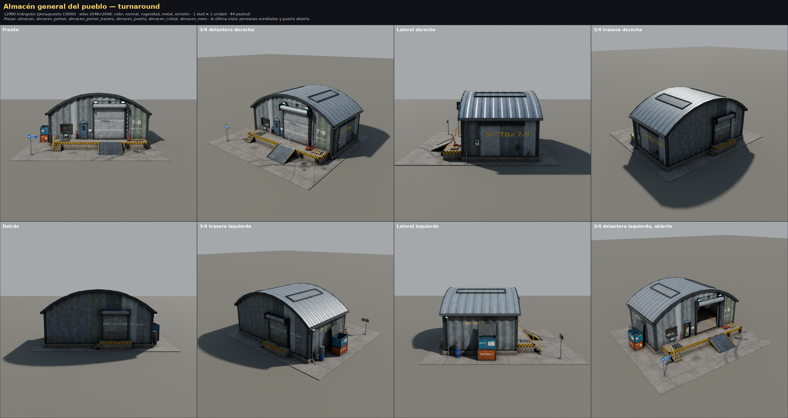

# Almacén general del pueblo

La despensa de la colonia: nave de chapa grecada con tejado en arco, muelle de carga con rampa abatible, portón
enrollable delante y otro más pequeño detrás, puerta de personal con oficina y el atrezo de un sitio donde se
acaba de descargar (transpaleta aparcada, palé vacío, contenedores, bidones esperando recogida).



| Archivo | Qué es |
| --- | --- |
| `almacen.fbx` | Las 6 mallas (con las texturas incrustadas) |
| `almacen_color.png` | Color base 2048² con la oclusión horneada. **RGBA**: el alfa es la transparencia del cristal armado y del policarbonato (opaco en todo lo demás) |
| `almacen_normal.png` | Normales en espacio tangente (OpenGL, +Y): onda del tejado, chapa lagrimada, poros del hormigón, arañazos y bordes biselados |
| `almacen_roughness.png`, `almacen_metalness.png` | Rugosidad y metal |
| `almacen_emision.png` | Emisión: focos, pantallas (dígitos), luces de la oficina y LEDs |
| `almacen.json` | Medidas, triángulos, pivotes, luces y anclajes en coordenadas de Blender y de Roblox |
| `almacen_turnaround.png` | 8 vistas (la última con las persianas enrolladas y la puerta abierta) |
| `almacen_detalles.png` | Primeros planos y la malla |
| `herramientas/` | El generador (todo sale de aquí; nada hecho a mano) |

**Medidas:** 17,1 × 15,7 × 7,2 studs con la explanada y el atrezo; el edificio, 13 × 7,5 × 7 (alero a 4,6). A esta
escala 1 stud ≈ 1,1 m: el muelle de 1 stud es la altura de la caja de un camión y el portón de 4 × 4 deja pasar una
carretilla cargada. **Ojo:** un R6 mide 5 studs, así que un personaje no cabe por la puerta de personal (2 studs).
Si el almacén tiene que ser transitable, hay que escalar el modelo entero (×2,5 lo deja a escala de personaje) o
decidir otra escala para todo el pueblo.

**Triángulos:** 12.990 de 13.000.

| Malla | Triángulos | En Studio |
| --- | ---: | --- |
| `almacen` | ~11.300 | Estructura, mecanismos, muelle, atrezo e interior. `SurfaceAppearance` con las 4 texturas. Anchored |
| `almacen_porton` | 582 | Persiana del portón principal: 17 lamas modeladas (una abollada, dos sustituidas), barra con asas y cerradura |
| `almacen_porton_trasero` | 542 | Persiana trasera, más gastada (óxido, abolladura), con tirador de correa |
| `almacen_puerta` | 354 | Puerta de personal con ventanilla de cristal armado, bisagras, manilla, llave puesta y cierrapuertas. `AlphaMode = Transparency` |
| `almacen_cristal` | 108 | Cristal armado de las ventanas, mirilla del contador y policarbonato de los tragaluces. `AlphaMode = Transparency`, sin sombra ni colisión |
| `almacen_neon` | 60 | Lentes de los 3 focos y pantallas de la báscula y el contador. Material **Neon** `#3DF2FF` |

Las 6 mallas comparten **un solo atlas**: se sube una vez.

## Importar en Studio

1. *Import 3D* → `almacen.fbx`, **Scale Unit = Stud** (el FBX está en studs: 1 unidad = 1 stud, «Apply Scalings: FBX All»).
2. Si no se crean solas, pon una `SurfaceAppearance` en cada malla con `ColorMap`, `NormalMap`, `RoughnessMap` y
   `MetalnessMap`. En `almacen_puerta` y `almacen_cristal`, `AlphaMode = Transparency`.
3. **Giro.** Antes de exportar se gira el modelo 180° sobre el eje vertical (`GIRO_IMPORTACION`) para compensar el giro
   que mete el importador de Roblox (comprobado con la región 1). Con eso las coordenadas «roblox» del json son
   `(x, z, -y)` de Blender y la fachada del portón queda hacia **+Z** del modelo. Si en Studio sale de espaldas, gira el
   modelo 180° en Y: **esto no se ha podido comprobar aquí** (esta sesión no tiene Studio).
4. Luces (posiciones en el json): `SpotLight` cian en `FocoMuelleIzq`, `FocoMuelleDer` y `FocoSeguridad`;
   `PointLight` cálida en `LuzOficina` y `LuzLampara`. Para móvil, basta con las dos del muelle.

### Animación

- **Portones:** el pivote de cada persiana está arriba, en la altura del eje del tambor. Enrollar = encoger `Size.Y`
  hasta `alto_abierto` dejando fijo el borde de arriba (igual que la persiana de la tienda de `modelos/ciudad_humana`).
  El tambor no cambia (está en el cuerpo).
- **Puerta:** pivote en el eje de las bisagras (lado izquierdo visto desde fuera); abre hacia fuera, 80-90°.

## La historia que cuenta

- **Portón:** arañazos horizontales hasta media altura de contenedores entrando, una lama abollada abajo a la
  izquierda, dos lamas más nuevas (sustituidas) y una más oscura; «MUELLE 1» a plantilla.
- **Paredes:** hojas de chapa de cuatro tonos (sustituidas en distintos momentos), regueros bajo el tejado, óxido
  abajo, remaches gruesos en las esquinas. «SECTOR 7-B» en amarillo con chorretones en la pared derecha; números de
  lote en las otras.
- **Suelo:** la explanada está **hundida** donde paran las ruedas traseras de los camiones (con charco), con
  rodadas que llegan a los topes, huellas de la transpaleta bajando la rampa y manchas de aceite. El muelle tiene
  arañazos de contenedores arrastrados hacia el portón y la franja amarilla del canto gastada.
- **Muelle:** báscula con el visor a 0000.0 kg, transpaleta aparcada con las horquillas rayadas, palé vacío con una
  tabla rota, rampa de chapa lagrimada con bisagras de nudillos, topes de goma para los camiones.
- **Oficina** (por la ventana): mesa con el libro de registro abierto, papeles, taza y la lámpara encendida;
  estantería de 3 niveles con cajas y archivadores; tablón de corcho.
- **Nave** (por el portón abierto y los tragaluces): estanterías de palés con mercancía, carga suelta y lámparas
  colgantes.

## Regenerar

```bash
.venv/bin/python pueblo/almacen/herramientas/generar.py
```

`--vista-previa` (sin hornear, ~3 min) para revisar la forma, `--rapido` (todo a 512) y `--contar` (solo triángulos).
Las medidas y los huecos están en `herramientas/datos.py`; la paleta de materiales, arriba de `generar.py`.

| Script | Para qué |
| --- | --- |
| `datos.py` | Medidas (studs), huecos, colores de neón |
| `geo.py` | Kit de sólidos cerrados en studs: cajas, extrusiones, tubos, chapa grecada con grosor |
| `modelo.py` | Todo el almacén, pieza a pieza |
| `materiales.py` | Materiales procedurales con capas (suciedad, óxido, arañazos, bordes gastados, calcos) |
| `imagenes.py` | Rótulos a plantilla, carteles, pantallas de 7 segmentos, rodadas, arañazos, manchas |
| `generar.py` | Paleta, atlas, horneado, renders, FBX y json |

## Qué no se ha comprobado

Nada se ha visto en Roblox Studio (esta sesión no lo tiene). Comprobado aquí: el FBX reimportado en Blender tiene
las 6 mallas con sus triángulos, una capa UV y el tamaño en studs (escala 1). Falta ver en Studio: la orientación
tras el giro, que el importador cree la `SurfaceAppearance`, el alfa del cristal y cómo queda la persiana al
encogerla.
