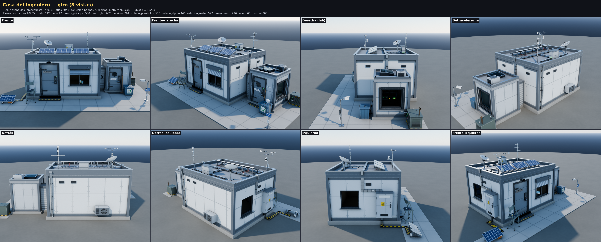
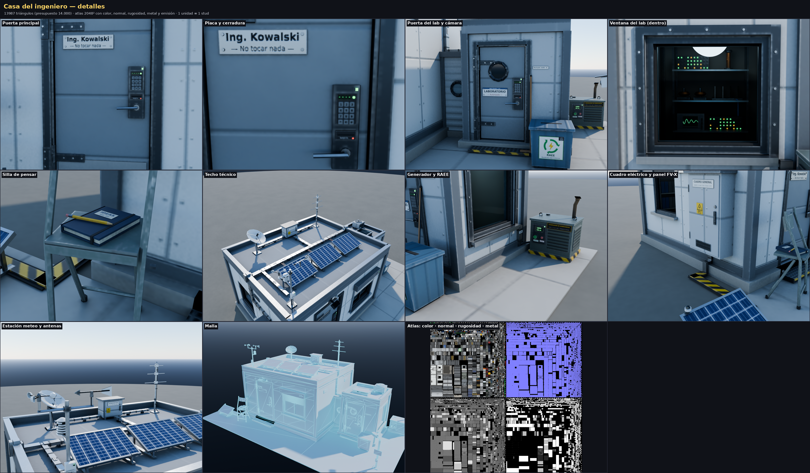

# Casa del ingeniero (`casa_ingeniero`)

La casa de **Ing. Kowalski**, la persona más técnica de la colonia: una casa modesta de paneles metálicos blancos con
un mini laboratorio adosado. Es la casa más «sci‑fi» del pueblo: parece una pequeña estación técnica.





> **No se ha visto todavía en Roblox Studio** (esta sesión no tiene Studio). Según CLAUDE.md, el director tiene que
> importarla y probarla con capturas antes de darla por buena. Ver «Qué comprobar en Studio».

## Archivos

| Archivo | Qué es |
| --- | --- |
| `casa_ingeniero.fbx` | 12 mallas (ver tabla de piezas). Texturas incrustadas |
| `casa_ingeniero_color.png` | Atlas 2048² de color (con la oclusión ambiental horneada) |
| `casa_ingeniero_normal.png` | Atlas de normales (espacio tangente) |
| `casa_ingeniero_roughness.png` | Atlas de rugosidad |
| `casa_ingeniero_metalness.png` | Atlas de metalicidad |
| `casa_ingeniero_emision.png` | Atlas de emisión: LEDs, pantallas, teclados, paneles de luz |
| `casa_ingeniero.json` | Pivotes, ejes de giro, luces, anclajes, triángulos y medidas (en coordenadas de Roblox) |
| `casa_ingeniero_turnaround.png` | 8 vistas cada 45° |
| `casa_ingeniero_detalles.png` | Primeros planos, malla y los mapas del atlas |
| `rondas/` | Hojas de las rondas de revisión anteriores |

## Medidas y presupuesto

- **1 unidad = 1 stud.** Casa 11 × 9 × 7,1 studs; laboratorio 4 × 4 × 5,3; pasillo cubierto entre los dos.
  Con la explanada, el panel del suelo y el poste de la cámara, el conjunto ocupa 24,2 × 14,2 studs de planta.
- **13.987 triángulos** (presupuesto 14.000). Por pieza, en `casa_ingeniero.json`.
- Grosor real en todas las piezas y normales hacia fuera. Solo se han quitado las caras que quedan pegadas a otra
  superficie (la trasera de una canaleta contra la pared, la base de un tornillo): no se ven nunca.

## Importar en Studio

1. **Import 3D** → `casa_ingeniero.fbx`.
2. **Scale Unit = Stud.** El FBX está escrito en studs (Apply Scalings: FBX All, sin escala de unidades), pero la
   cabecera dice metros: si se deja en *Meter* la casa sale 3,57 veces más grande.
3. La fachada (puerta principal) llega mirando a **-Z** y el lab queda en **-X**: ya lleva aplicado el
   GIRO_IMPORTACION (180° sobre Y antes de exportar).
4. Texturas: todas las MeshPart salvo `_cristal` y `_neon` usan **el mismo atlas**. Una `SurfaceAppearance` por
   pieza con `ColorMap`, `NormalMap`, `RoughnessMap` y `MetalnessMap` (si el importador no la crea sola, sube los
   cuatro PNG y pon los IDs). `emision.png` es la máscara de lo que brilla (para `EmissiveMaskContent` si se usa).
5. `casa_ingeniero_cristal` → Material **Glass**, color `#DCEEF5`, transparencia 0,35.
   `casa_ingeniero_neon` → Material **Neon**, color `#DFF1FF` (el foco LED de la puerta, blanco frío).
6. Ancla todo menos las piezas animables (o ánclalas también y anímalas por CFrame desde el servidor).
7. Luces (posiciones en el JSON, `luces`): `SpotLight` en el foco de la puerta y `PointLight` dentro del lab y de
   la casa. Sin ellas, lo que se ve por las ventanas queda a oscuras.

## Piezas

| Malla | Qué es | Animación |
| --- | --- | --- |
| `_estructura` | Casa, lab, pasillo, techo técnico, canaletas, cuadro, generador, contenedor, silla, panel del suelo, poste de la cámara, explanada | — |
| `_puerta_principal` | Puerta metálica con cerradura electrónica (teclado + lector de tarjeta), placa «Ing. Kowalski — No tocar nada», 2 bisagras industriales | Gira sobre Y en el pivote (bisagras), hacia fuera |
| `_puerta_lab` | Puerta más pequeña con ojo de buey, la misma cerradura y el cartel «LABORATORIO — Autorizado» | Igual |
| `_persiana` | Persiana automática de la ventana frontal (bajada un tercio) | `Size.Y` con el borde de arriba fijo (ver JSON) |
| `_antena_parabolica`, `_antena_dipolo`, `_estacion_meteo` | Antenas y estación del techo | — |
| `_anemometro` | Las 3 cazoletas | Giro continuo sobre Y |
| `_veleta` | La veleta | Oscilación lenta |
| `_camara` | Cabezal de la cámara de seguridad (apunta a la puerta del lab) | Barrido sobre la rótula |
| `_cristal`, `_neon` | Cristales y foco LED | — |

Los pivotes están en el FBX (origen de cada objeto) **y** en el JSON, por si el importador no los conserva: en ese
caso, pon `PivotOffset` para que el pivote quede en la posición del JSON.

## La historia que cuenta

- **Las antenas** (parabólica, dipolo de tres pisos, estación meteorológica): escucha las estrellas.
- **Las canaletas**: todos los cables van por canaletas galvanizadas con tapa y abrazadera cada 0,5 studs, y
  etiquetados (FV‑1, FV‑2, FV‑3, ANT‑P, ANT‑D, METEO, CUADRO, LAB, TECHO, GEN, SOLAR‑X, CAM).
- **El lab adosado**, con ventana de doble cristal y marco atornillado: dentro se ven estantes con equipos de
  LEDs, un osciloscopio encendido, bobinas de cobre y placas de circuito.
- **La silla de pensar**: lo único viejo. Pintura gastada hasta el acero en las aristas, en el asiento y en el
  respaldo, con arañazos. Encima, el cuaderno «IDEAS vol. 14» cerrado con su goma y un lápiz.
- **La cámara** apunta a la puerta del lab, con su cartel «Zona vigilada 24 h».
- **El panel FV‑7 del suelo**, «PROTOTIPO · Experimental», con su registrador midiendo (LED ámbar) y el cable por
  una canaleta pisable hasta el cuadro.
- **La explanada** está limpia (juntas de dilatación, sin manchas) y hay una escoba apoyada en el lab.

## Regenerar

```bash
python3 -m venv .venv && .venv/bin/pip install -r modelos/herramientas/requirements.txt
```

```bash
.venv/bin/python pueblo/herramientas/casa_ingeniero.py --salida pueblo/casa_ingeniero
```

`--rapido` hornea a 512² y renderiza a baja resolución (unos 4 minutos). La versión completa tarda bastante más
(el horneado de la oclusión a 2048² y los 19 renders).

| Script (`pueblo/herramientas/`) | Para qué |
| --- | --- |
| `kit_casas.py` | Kit común para las casas del pueblo: geometría (cajas, placas con huecos, tubos, lofts...), sombreadores procedurales escritos con operadores, atlas común, horneado de los 5 mapas, estudio, exportación |
| `materiales_ingeniero.py` | Materiales y paleta de esta casa (todo lo ajustable arriba) |
| `letreros_ingeniero.py` | Hoja de letreros: placa, carteles, pegatinas, teclado, pantallas, etiquetas |
| `casa_ingeniero.py` | La casa: medidas arriba, una función por parte |
| `render_ingeniero.py` | Vistas del giro y primeros planos |
| `verificar_fbx.py` | Reimporta el FBX y muestra mallas, triángulos, tamaño, centro y pivote |

## Qué comprobar en Studio

- Que con *Scale Unit = Stud* la casa mide 11 × 9 studs y la puerta principal 2,6 × 5 (un R6 pasa justo).
  La puerta del lab mide 2 × 3,95: es más baja a propósito («más pequeña»); si tiene que pasar un personaje, hay
  que subir `LAB.z1` y `PUERTA_LAB.z1`.
- Que las puertas giran sobre las bisagras y no atraviesan el cerco.
- Que el atlas se ve nítido en los letreros (la placa del nombre y el cartel del lab tienen más resolución que el
  resto) y que los LEDs del lab se leen a través del cristal.
- Rendimiento: 12 MeshPart y una sola textura de 2048² compartida.
