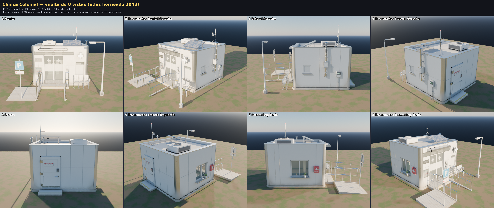
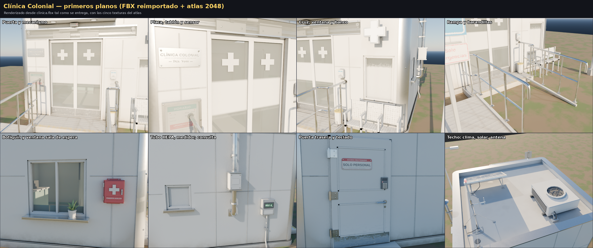

# Clínica Colonial (`pueblo/clinica/`)

La clínica del pueblo: el único sitio médico de la colonia, de la Dra. Voss. Edificio pequeño de una planta con techo
alto, paneles blancos impecables, cruz médica luminosa en la fachada, rampa para camillas y su entorno inmediato
(banco de espera, papelera médica, señal de parking y farola).





> **Todavía no se ha visto en Roblox Studio.** Esta sesión no tiene Studio: el modelo está hecho y comprobado en
> Blender (el FBX se reimporta en una escena vacía y `clinica_detalles.png` está renderizado desde ese FBX), pero según
> `CLAUDE.md` el director tiene que importarlo y probarlo en Studio, con capturas, antes de darlo por bueno.

## Archivos

| Archivo | Qué es |
| --- | --- |
| `clinica.fbx` | El modelo: 19 mallas (una `MeshPart` por pieza), texturas incrustadas |
| `clinica_color.png` | Atlas 2048² de color, con la oclusión horneada y el **alfa de los cristales** |
| `clinica_normal.png` | Normales (espacio tangente) |
| `clinica_roughness.png` | Rugosidad |
| `clinica_metalness.png` | Metal |
| `clinica_emision.png` | Emisión (cruz, luces, pantalla del medidor, LED, baliza) |
| `clinica_turnaround.png` | 8 vistas alrededor, con el atlas horneado |
| `clinica_detalles.png` | 8 primeros planos, renderizados desde el FBX reimportado |
| `clinica.json` | Piezas, triángulos, pivotes, animación de las puertas, luces y anclajes (en ejes de Roblox) |
| `herramientas/` | El generador (todo sale de aquí, nada hecho a mano) |

## Medidas y presupuesto

- **1 unidad = 1 stud.** Edificio de 10,4 × 10 studs de planta y 7,4 de alto (remate del pretil). Con los equipos del
  techo llega a 11 (la antena); con la rampa, el banco, la señal y la farola ocupa unos 14,4 × 16,5.
- **11.617 triángulos** de 12.000. Se quitan solas las caras que nunca se ven (apoyadas en el suelo o pegadas cara a
  cara contra otra pieza); todas las piezas siguen siendo sólidos con grosor y con las normales hacia fuera (se comprueba
  en las 676 piezas sueltas).
- **GIRO_IMPORTACION** aplicado: 180° alrededor del eje vertical antes de exportar. La fachada mira a **-Z**, el
  delante de Roblox.

## Importar en Studio

1. **File → Import 3D** y elige `clinica.fbx`. Escala: el FBX va con *Apply Scalings = FBX All* y 1 unidad = 1 stud.
   Si el edificio no sale de ~10 studs de ancho, cambia la unidad del importador a *Stud*.
2. Marca **Anchored** (todo salvo las puertas, que se anclan igual y se mueven por Tween).
3. Cada pieza sin `_neon` lleva una `SurfaceAppearance` con el atlas: `ColorMap`, `NormalMap`, `RoughnessMap` y
   `MetalnessMap` (si el importador no la crea, súbelas con *Bulk Import* y ponlas a mano; todas usan las mismas
   cuatro texturas). En las piezas con `Cristal` en el nombre, **AlphaMode = Transparency**; en el resto, Overlay.
4. Las piezas `_neon`: **Material = Neon** y el color de `clinica.json` (la cruz `#FFFFFF`, la marquesina blanco cálido
   `#FFE1B5`, la farola `#FFFFFF`...). `Medidor_neon` lleva cifras en la textura: si se quieren ver, déjala con la
   `SurfaceAppearance` en vez de Neon.
5. Luces: `clinica.json → luces` da la posición de cada `PointLight`/`SpotLight` (cruz, dos focos de la marquesina,
   farola, techo interior, baliza). Con muchas clínicas a la vista, deja solo las cercanas (móvil).
6. Colisión: `Edificio`, `Interior`, `Rampa` y `Mobiliario` con `PreciseConvexDecomposition`; `Detalles`,
   `Techo_Equipos` y los neones con `CanCollide = false`.

## Piezas

| Pieza | Qué lleva |
| --- | --- |
| `Edificio` | Zócalo de hormigón pintado, paredes de paneles con juntas de silicona, perfiles de esquina redondeados atornillados, remate, forjado, ventanas (marcos, junquillos, cordón, alféizares), el aloe vera en su maceta, marquesina con tirantes, el mecanismo de las correderas (raíl, poleas, correa, motorreductor, tapa) y el sensor |
| `Interior` | Suelo de vinilo, rodapié, tabiques de la consulta con su puerta, mostrador, bancada de espera, cartel |
| `Techo_Equipos` | Climatizador con lamas, ventilador (aspas, buje, rejilla), panel de filtros atornillado, tubos frigoríficos; panel solar inclinado con patas y caja de conexiones; antena de emergencias con dipolos, vientos y baliza |
| `Detalles` | Cruz (carcasa metálica y brazo), placa grabada «CLÍNICA COLONIAL — Dra. Voss», tablón con cristal y el HORARIO, dispensador de gel, botiquín rojo, medidor de energía, tubo de ventilación con filtro HEPA, abrazaderas y sombrerete |
| `Rampa` | Rellano, rampa antideslizante con franjas de aviso y rodadas, bordillos, barandillas con pasamanos y barra intermedia, escalón trasero |
| `Mobiliario` | Banco de 3 asientos de chapa perforada con patas atornilladas, papelera médica con pedal y símbolo de residuos, señal «P / Solo emergencias», farola blanca |
| `Cristales` | Ventana frontal (esmerilada hasta 2/3), lateral de la sala de espera (transparente), consulta (esmerilada), tablón y tapa del mecanismo |
| `Puerta_Izq` / `Puerta_Der` | Hojas correderas con bastidor, chapas de protección abolladas, goma central, carro con ruedas y pinza de la correa |
| `Puerta_Izq_Cristal` / `Puerta_Der_Cristal` | Cristal con franja esmerilada y la cruz en relieve a los dos lados (soldar cada una a su hoja) |
| `Puerta_Trasera` | Hoja de suministros con nervios, bisagras, manilla y bombín, cerradura de teclado (12 teclas modeladas, LED) y cartel «SOLO PERSONAL» |
| `*_neon` | Cruz, dos luces de la marquesina, farola, pantalla del medidor, LED del sensor, techo interior, baliza |

## Puertas

- **Correderas** (`Puerta_Izq`, `Puerta_Der`): el pivote está en el centro de cada hoja, a ras de suelo. Abrir es
  mover el `CFrame` `desplazamiento_abrir` (1,8 studs hacia cada lado): las hojas entran en la pared y el carro corre
  por el raíl. Suelda cada cristal a su hoja (`WeldConstraint`) y mueve solo la hoja. Propuesta: abrir 0,6 s Quad Out,
  cerrar 0,8 s Quad InOut a los 3 s sin nadie delante; LED del sensor verde al detectar.
- **Trasera** (`Puerta_Trasera`): el pivote está en el eje de las bisagras. Abrir = `pivote * CFrame.Angles(0,
  math.rad(-95), 0)` (hacia fuera).

Todo eso es código que **no** está en esta rama: aquí solo va el modelo.

## La historia en los materiales

- Paneles blancos impecables, con polvo que sube del suelo y se acumula en las esquinas bajas del edificio.
- Marcas de goma negra, roces y pintura saltada en la parte baja de las puertas; chapas inferiores abolladas y
  rayadas (las camillas entrando de urgencia).
- Rampa con bandas antideslizantes, franjas amarillas gastadas y rodadas de camilla.
- El botiquín, el gel y el banco limpios: la doctora piensa en todo.

## Regenerar

Hace falta `bpy` (Blender 5.x como módulo de Python), `numpy` y `pillow`:

```bash
python pueblo/clinica/herramientas/pipeline.py --salida pueblo/clinica
```

```bash
python pueblo/clinica/herramientas/vista_fbx.py --carpeta pueblo/clinica
```

`--previa` construye y renderiza unas vistas con los materiales procedurales sin hornear (rápido, para revisar la
geometría). Módulos: `geo.py` (primitivas en bmesh), `clinica.py` (el edificio), `materiales.py` (materiales
procedurales), `rotulos.py` (los textos), `pipeline.py` (UV, horneado, exportación, vuelta, JSON).

## Qué hay que comprobar en Studio

- Que el importador lo deja a escala de studs y mirando a -Z.
- Que la `SurfaceAppearance` de los cristales en Transparency se ordena bien con el interior detrás.
- Que las hojas correderas quedan ocultas dentro de la pared al abrir (los bolsillos tienen el hueco justo).
- El aspecto del Neon de la cruz frente a la emisión que se ve en las vistas.
